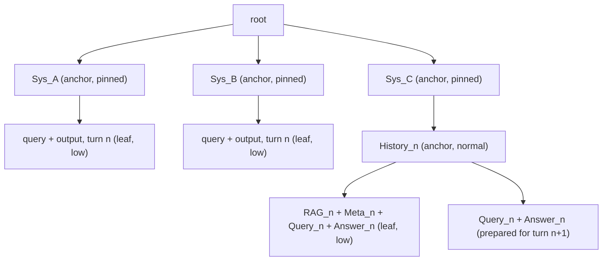

# Radix tree KV cache: design

Status: draft. Nothing in this document is implemented yet. It records the high-level design so that later phases can refer to it and update it as decisions change.

Related pages:
- [build.md](build.md): how to build for the laptop and the phone.
- [phase_0_baseline.md](phase_0_baseline.md): measurements of the stock server that motivate this design.
- [BUGS.md](../../BUGS.md): bugs found in the stock prompt cache.
- [llama_kv_caching.md](../../llama_kv_caching.md): the earlier slot-registry proposal. This design replaces its storage model and keeps its workload and goals.

## Goal

Agent apps on laptops and phones call one model several times per user turn, each time with a different static system prompt, in a fixed cycle. This design keeps every reusable prefix cached once, in the cheapest tier where it is worth keeping.

The target workload is the 3-stage turn from the Phase 0 benchmark: a router, a tool extractor, and a response writer with a growing chat history and new RAG documents, plus an occasional background task. The target devices are:

| Device | Memory | What matters most |
| --- | --- | --- |
| Laptop with a discrete GPU (RTX 3060, 6 GB VRAM) | Small KV pool in VRAM, large RAM | Copies between RAM and VRAM; a restore must beat the GPU's fast prefill |
| Phone (Pixel Fold, CPU) | One shared memory, slow prefill (about 100-155 tokens/s) | Every missed token costs milliseconds; memory pressure; app restarts |

The design must work for three model types: full attention (for example Llama 3.2), sliding-window attention (Gemma 3), and hybrid recurrent models (LFM2).

## What the stock server does today

Today each slot owns its cached prompt, the RAM cache moves whole slot states in and out, and a full KV pool wipes a whole idle slot. Phase 0 measured what this costs.

- **Slots own their state.** A slot's KV cells carry its sequence ID, and `slot.prompt` lists the tokens in them. Which slot a request lands on decides whether it hits.
- **The RAM prompt cache** (`--cache-ram`) is a flat list of whole-slot blobs. It finds the longest prefix match by linear scan, skips matches below 25% of the entry (`f_keep`), evicts the oldest entry first, and *moves* an entry into a slot on restore.
- **When the KV pool is full,** `try_clear_idle_slots()` wipes the first idle slot that holds tokens, with no write-back to RAM. Its TODO says: "move slot to level 2 cache instead of removing?"
- **Hybrid and SWA models** can only resume at checkpoints, which the server creates at user-message starts and near the end of the prompt.

Phase 0 results that shaped this design:

| Finding | Number | Design response |
| --- | --- | --- |
| One slot with no RAM cache: each stage overwrites the previous one | Phone turn time 2x, energy 2x (config F) | Prefixes belong to the tree, not to a slot |
| RAM swaps are nearly free on the phone, costly on the laptop | Phone 85 ms per turn (of 22 s), laptop 131 ms per turn (A is 8% slower than C) | Restore only when it beats recomputing (see "Restore or recompute") |
| A small RAM cache gives an eviction cliff | Stage 3 hit 55% -> 1.5%, turn time +66% on the phone (config D) | Store shared prefixes once, at node granularity |
| Pinned background task never restores (BUG-001) | 0% hit vs 40-52% ideal | Slots become stateless, so slot choice cannot cause a miss |
| Hybrid and SWA checkpoints land after the shared prefix | Gemma and LFM2 stage hits near 0% in most configs | Resume points at anchors and on a grid |

## Background: cells and sequence tags

The design reuses two existing llama.cpp mechanisms: KV cells with sequence-tag bitsets, and the unified KV cache, where all sequences draw cells from one pool.

- **A KV cell** is one token's K and V vectors in every attention layer, plus metadata: its position `pos[i]` and a bitset `seq[i]` of up to 256 sequence IDs (`src/llama-kv-cells.h`). Cells live wherever the KV buffer was allocated: VRAM on a discrete GPU, system RAM on the CPU backend or on unified-memory hardware.
- **The mask rule.** A token of sequence `s` at position `p` attends only to cells whose `seq[i]` contains `s` and whose `pos[i] <= p`. Cells of other sequences are invisible, even at the same positions.
- **Tags act as a reference count.** `seq_cp(src, dst)` adds tag `dst` to every cell tagged `src`, with no K/V bytes copied. `seq_rm(s)` removes tag `s`, and a cell is freed only when its tag set becomes empty.
- **Cell sharing needs the unified KV cache** (`--kv-unified`), a software setting that works on any hardware. Without it, each sequence has its own buffer and `seq_cp` must copy bytes. The server turns it off when `-np` is passed without `--kv-unified`.
- **Recurrent layers** have no per-token cells. They keep one state per sequence that summarizes the whole history.

A prefix kept in the pool under a sequence ID that no slot uses is a **parked sequence**. Any slot can attach it with one `seq_cp`, and several slots can attach it at the same time.

## Overview: one shared prompt tree

The server keeps one radix tree of token runs, shared by all slots. The tree owns every cached prefix. Slots only borrow prefixes for the length of a request, so any slot can serve any request at the same cost.

### Trie vs radix tree

A trie (prefix tree) stores keys along paths from the root, so keys with a common prefix share the start of their path. A radix tree (also called a compact prefix tree) is a trie with path compression: each chain of nodes that have one child is merged into one node, which then holds a run of symbols instead of one symbol.

With the words "car", "cart", and "cat":

```
trie (one letter per node)          radix tree (runs of letters)

c -> a -> r -> t                    "ca" -> "r" -> "t"
          \-> t                          \-> "t"
```

The trie needs a node for every letter. The radix tree keeps only the nodes where words branch or end. Lookup, insert, and delete take time proportional to the key length, not to the number of keys stored.

Here the symbols are tokens, and a key is a prompt. Two prompts that share a 1,500-token system prompt give:

```
trie: 1,500 single-token nodes, then a branch

radix tree:   [system prompt, 1,500 tokens] -> [query A + answer A, 300 tokens]
                                           \-> [query B + answer B, 120 tokens]
```

So a node holds as many tokens as it needs, and new nodes appear only where prompts diverge. That is why a split can happen at any token (see "Splits"). The word "radix" is historical, and it does not mean binary or bit-level indexes here.

### The tree in this design



*Shared prefixes sit near the root and one-off tails are leaves. Each node records which tiers hold its data.*

A request's lifecycle:

| Step | Today | Radix tree design |
| --- | --- | --- |
| Request starts | Reuse the slot's own cells, or swap with RAM (copy out, copy in) | Attach the longest cached match: tag its cells with the slot's sequence ID |
| Request runs | Writes new cells under its own ID | Same |
| Request ends | Keeps everything; the state is tied to this slot | Hands its new cells to the tree (re-tags them with a leaf ID), then drops its own tag |
| After the request | The slot "contains" a prompt | The slot holds nothing |

Pinning (`id_slot`) stays as a scheduling tool, a reserved lane, but no longer affects cache hits.

## Nodes

A node is a run of tokens on one path of the tree, with metadata. Its K/V data never changes after it is computed, so copies in different tiers can never be stale.

Each node holds:
- its token span `[p0, p1)` and a chained hash of its path, with the LoRA set and media hashes folded in;
- its locations: cells in tier 0, a list of blocks in tier 1 or tier 2 (see "Node granularity"), or several of these;
- a list of snapshot positions for recurrent and SWA state (see "Hybrid, recurrent, and SWA models");
- a reference count: requests attached to it now, or restores in progress;
- a hit count with aging, a last-use time, and a priority.

**Sequence IDs.** IDs are limited to 256, so not every node gets one. Each tier-0 leaf gets one parked ID. An inner node is represented by the cells that every leaf below it tags. Anchor nodes, such as a pinned system prompt, also get their own ID, so they stay in the pool when all their leaves are evicted. `n_seq_max` must cover the slots plus the parked IDs.

**Immutability.** A token's K and V vectors depend only on the tokens before it on its path, its position, the model weights, the LoRA set, and the KV type. The node's identity fixes all of these. So every tree operation only adds data or changes metadata:

| Operation | What changes | Existing K/V bytes |
| --- | --- | --- |
| Attach a prefix | Tags | Unchanged |
| Prefill or generate | New cells | Unchanged |
| History grows | A new child node | Unchanged |
| A node splits | Token ranges in the index | Unchanged |
| Hits, recency, priority | Index metadata | Unchanged |

No write-through or write-back protocol is needed for correctness. A tier holds a node, or it does not.

**Splits.** Lookup can diverge inside any node on the path, not only at a leaf. If node X covers `[a, b)` and a new prompt diverges at `m`:
1. X shrinks to `[a, m)`.
2. A new child X' takes `[m, b)` and all of X's old children.
3. A new child Y gets the new prompt's tokens from `m` on.

In tier 0 the cells stay where they are. In tiers 1 and 2, the block references move between X and X', and no stored data is copied or sliced (see "Node granularity").

**Lookup.** No two children of a node start with the same token, so each level is a dictionary lookup on the next token, followed by a token-by-token compare along the node's run. Child order does not matter for lookup.

## Storage tiers

Data lives in up to three tiers. A node's data is computed in tier 0 and moves down under memory pressure. On unified-memory devices tier 1 is the same memory as tier 0, so the chain is tier 0 to flash.

| Tier | Storage | Unit | Budget | Main use |
| --- | --- | --- | --- | --- |
| 0 | KV pool (VRAM, or RAM on CPU and unified memory) | Cells tagged with parked IDs | A token budget inside `-c` | Hot prefixes, zero-copy attach |
| 1 | Host RAM | Byte blobs (`llama_state_seq_get_data`) | `--cache-ram` | Discrete GPUs only |
| 2 | Flash | Files with a fingerprint | A disk budget and a directory | Static prefixes across app and server restarts |

**When data gets a lower copy.** New nodes are created in tier 0. Copying them down is a cost decision, not a correctness one:
- **Lazy (like write-back):** copy a node to RAM only when it is evicted from tier 0. Uses the least RAM, but evicting costs a copy when memory is tight. Default for normal-priority nodes.
- **Eager (like write-through):** copy right after creation. Later eviction from tier 0 is free, and a flash copy survives restarts. Default for pinned and high-priority nodes.

**Inclusive or exclusive.** An inclusive hierarchy keeps the RAM copy when a node is promoted, so demoting it again is free. An exclusive hierarchy, like today's move-on-restore, saves RAM but pays a write on every demotion. Default: inclusive for pinned and high nodes, exclusive for the rest.

**Flash specifics.** Each file records the model file hash, the KV type, the LoRA set, and the state format version, and files that do not match are deleted. Only pinned and high nodes are written, once each, to limit flash wear. The OS can delete these files at any time (Android "clear cache", iOS cache purge), which only causes a cold prefill.

## Node granularity

Decision: the index is a radix tree with exact splits, and tiers 1 and 2 store K/V in fixed blocks of `B` tokens (option 3 below). This section records why. The block size is separate from the snapshot grid for hybrid and SWA models.

**Terms.**
- **Trie (prefix tree):** a tree where each edge is one token. A path from the root spells a token sequence, and prompts that share a prefix share the path.
- **Radix tree:** a trie where each chain of single-child nodes is merged into one node that holds a token run of any length (see "Trie vs radix tree"). This design's index is a radix tree.
- **Index:** the tree itself, which says which token runs are cached and in which tier. It holds metadata only, not K/V data.
- **Storage unit:** how the K/V bytes of a node are laid out in tiers 1 and 2. This is the open question in this section.
- **Block (piece):** a fixed run of `B` tokens' K/V, at positions `[k * B, (k + 1) * B)`.

**Two known designs.** Both are prefix trees, and they differ in their unit:

| | Radix tree (SGLang style) | Hashed blocks (vLLM style) |
| --- | --- | --- |
| Unit | A variable-length edge, split exactly where two prompts diverge | A fixed block of `B` tokens (for example 16). The hash of a block includes its parent's hash, so a hash identifies a whole path |
| Lookup | Walk the tree, one dictionary lookup per node on the next token | One hash lookup per full block; a partial last block needs a scan |
| Divergence inside a unit | Split the node; reuse is exact to the token | The block is not shared; up to `B - 1` tokens are recomputed |
| Stored data | One range per node, which must be sliced when the node splits later | One fixed-size piece per block, which never changes |

**Tier 0 does not care.** Cells and tags work per token, so a split in tier 0 is free at any position. The choice only affects how tiers 1 and 2 store data, how flash files are named and checked across restarts, and how much work a split costs.

**The problem: a split after the data is saved.** Node X holds a 4,000-token chat history and was demoted to RAM as one blob. A new request matches the first 100 tokens and then diverges, so the index splits X into X1 `[0, 100)` and X2 `[100, 4000)`. The new request needs only X1, but X1's data sits inside X's blob. There are two ways to get it:
- **Slice the blob.** The blob stores K and V per layer, and V is often transposed, so taking tokens 0-99 means per-layer offsets and strided copies. This needs a new range API in `llama_state_seq_*`.
- **Restore all of X, then trim.** Load 4,000 tokens and `seq_rm` the last 3,900 cells, which is free in tier 0. But the load is 125 MiB, about 11 ms over PCIe, which is about the same as recomputing the 100 tokens. The waste has no upper bound: it grows with the length of the saved node.

**Options:**
1. **Radix index, one blob per node.** Each node's K/V is one blob in tiers 1 and 2, sliced (or re-saved) on split. Simplest storage, exact reuse, no duplicate data. Depends on a cheap range API.
2. **Blocks everywhere.** Index and storage both use `B`-token blocks, as in vLLM. Simple fixed-size storage and flash files, and deduplication by hash. Loses up to `B - 1` tokens of reuse at each divergence, even in tier 0, where an exact split would be free. Anchors must fall on block boundaries.
3. **Radix index, block storage (chosen).** The index keeps exact splits, as in option 1. Tiers 1 and 2 store data in pieces of `B` tokens at fixed positions (`[0, B)`, `[B, 2B)`, ...), and a node is a list of pieces. A restore loads whole pieces and trims the extra cells with `seq_rm`, so it never needs a slice and over-reads at most `B - 1` tokens.

**Example of option 3.** `B = 4`, and prompt P1 (14 tokens) is saved to RAM as node X:

```
position   0  1  2  3 |  4  5  6  7 |  8  9 10 11 | 12 13
node X     [-------------------- P1 ---------------------]
pieces     [    p0    ][    p1     ][     p2     ][ p3  ]
```

Prompt P2 then matches tokens 0-9 and diverges at token 10. The index splits X at 10:

```
position   0  1  2  3 |  4  5  6  7 |  8  9 | 10 11 | 12 13
X1 [0,10)  [    p0    ][    p1     ][ 8  9 ]
X2 [10,14)                          [ p2 (8-11)    ][ p3  ]   path P1
Y  [10,..)                          [ p2' (8-11)   ] ...      path P2, once saved
```

- **The split touches no stored data.** X1 takes p0 and p1, and X2 takes p2 and p3. Only piece references move.
- **A piece that crosses a node boundary belongs to the child.** p2 holds tokens 8-9 (shared) and 10-11 (P1 only). Its K/V for tokens 10-11 depend on P1, so it belongs to X2. When Y is saved, it gets its own p2' with P2's tokens 10-11, so tokens 8-9 are stored twice. "Blocks at a branch point" below shows how this grows with more children.
- **Restoring X1 alone** loads p0 and p1 (8 tokens), then either recomputes tokens 8-9 or loads p2 and trims tokens 10-11. Either way the extra work is below `B` tokens, whatever the length of X.

**Choosing `B`.** Phase 1 measured \(T\) at about 1 token on the laptop and 0 on the phone, so restoring is almost always better than recomputing, and a leaf's short last block is worth keeping on both devices. Duplicates at branch points stay small at any practical `B` (see "Blocks at a branch point" below), so memory does not decide `B`. The per-call overhead does: about 0.10 ms per restore call and 0.42 ms per save call, so at `B = 16` a save costs 5.7x one whole-state copy (see [phase_1_measurements_results.md](roadplan/phase_1_measurements_results.md)). Phase 2 starts with `B = 64` and the existing library calls, and moves to `B = 16` if a batched block call removes the per-call overhead.

**Sequence IDs are a tier-0 limit only.** The 256-ID limit (`LLAMA_MAX_SEQ`) applies to cells in the KV pool. Blocks in tiers 1 and 2 are plain bytes with no sequence IDs, so the storage choice does not touch the limit. A restore writes blocks into cells under one sequence ID, the same as any tier-0 node.

**This is not the snapshot grid.** Hybrid and SWA models need resume points every `S` tokens (see "Hybrid, recurrent, and SWA models"). That is a different setting with a different purpose: `S` bounds how far back a recurrent model must recompute after a surprise divergence, and `B` is a storage unit. Choosing `S` as a multiple of `B` keeps snapshots on piece boundaries, but neither depends on the other.

**Why option 3.** It keeps exact reuse in tier 0, where splits are free, and bounds the waste of every restore to `B - 1` tokens without an API that loads part of a saved blob. The cost is a list of block references per node and up to `B - 1` duplicate tokens per branch. Option 2 is close, but it rounds splits in tier 0 too and forces anchors onto block boundaries. Option 1 stays a fallback if a cheap partial-load API turns out to exist.

**What it needs from the library.** A call that saves the K/V of positions `[k * B, (k + 1) * B)` of a sequence into a buffer, and a call that loads a list of blocks into cells under one sequence ID in one call. One call per run, not per block, keeps the fixed restore overhead from growing with the number of blocks.

### Blocks at a branch point

This example follows one node from leaf to branch point, to show which blocks exist at each step and where tokens are stored twice. `B = 4`. A system prompt S has 10 tokens (positions 0-9), and the stages A, B, and C, then a new request D, each continue it at position 10.

**Step 1: S is a leaf.** S stores two full blocks and a short last block for tokens 8-9. A short block holds only its own tokens, so it uses the memory of 2 tokens, not 4.

```
position   0  1  2  3 | 4  5  6  7 | 8  9
S          [s  s  s  s]|[s  s  s  s]|[s  s]        2 full blocks + short block (8-9)
```

**Step 2: A is saved.** A's first block covers positions 8-11. Tokens 10-11 are A's own, so the block belongs to A, and it also holds S's tokens 8-9. S's short block is now redundant and is freed.

```
position   0  1  2  3 | 4  5  6  7 | 8  9 10 11 | 12 13 14 15
S          [s  s  s  s]|[s  s  s  s]                             short block freed
A                                  [s  s  a  a]|[a  a  a  a] ...
```

**Step 3: B and C are saved.** Each gets its own block at positions 8-11, because its tokens 10-11 differ. S's tokens 8-9 are now stored three times, once per child.

```
position   0  1  2  3 | 4  5  6  7 | 8  9 10 11 | 12 13 14 15
S          [s  s  s  s]|[s  s  s  s]
A                                  [s  s  a  a]|[a  a  a  a] ...
B                                  [s  s  b  b]|[b  b  b  b] ...
C                                  [s  s  c  c]|[c  c  c  c] ...
```

**Step 4: D arrives.** D matches S and diverges at position 10. To restore S, load S's two blocks, then the block at positions 8-11 of any child (A, B, or C, since all three hold tokens 8-9), then remove positions 10-11 with `seq_rm`. D prefills from position 10, and once it is saved, it adds its own block at positions 8-11.

**How many tokens are stored twice.** Let `p` be the position where the children start (here 10). The tokens of S after its last full block are positions `B * floor(p / B)` to `p - 1`, so there are `r = p mod B` of them (here 10 mod 4 = 2: tokens 8 and 9).
- Every child's first block starts at `B * floor(p / B)`, so every child stores those `r` tokens.
- With `k` children there are `k` copies. One copy is needed, so `(k - 1) * r` tokens are duplicates. Here: (3 - 1) x 2 = 4 tokens.
- With one child there is no duplicate, because S's short block is freed.
- If `p` is a multiple of `B`, then `r = 0`: no block crosses the boundary and nothing is stored twice.

**The average of `r`.** `r` is between 0 and `B - 1`. If branch positions fall anywhere relative to block boundaries, each value is equally likely, so the average is \((0 + 1 + \dots + (B-1)) / B = (B-1)/2\). This is an assumption, not a measurement. A fixed system prompt always branches at the same position, so its `r` is one fixed value: a 1,500-token prompt with `B = 64` has `r = 1500 mod 64 = 28` for every branch.

For Llama 3.2 1B (32 KiB per token), the duplicate per extra child is:

| `B` | Average (\(r = (B-1)/2\)) | Worst case (\(r = B - 1\)) |
| --- | --- | --- |
| 16 | 0.23 MiB | 0.47 MiB |
| 64 | 0.98 MiB | 1.97 MiB |
| 256 | 3.98 MiB | 7.97 MiB |

**When the last child is evicted,** S becomes a leaf again without its short block, so restoring S recomputes its last `r` tokens (fewer than `B`). A later version could keep them by loading the child's first block into a scratch sequence, trimming it, and saving it as S's short block before the child is freed.

## Request flow

A request walks the tree, attaches the cached part of its prompt, prefills the rest, and hands its new cells to the tree when it ends.

1. **Match.** Walk the tree with the prompt tokens to the deepest matching position. Step back to the nearest resume point at or before it (for full attention, every token is a resume point).
2. **Choose what to restore.** For the part of the match that is not in tier 0, apply the rule in "Restore or recompute".
3. **Attach.** `seq_cp(leaf_id, slot_seq)` for the tier-0 part. Promote restored nodes into tier 0 under a parked ID first, top-down (ancestors before children), then attach.
4. **Load the snapshot** if the model has recurrent or SWA layers.
5. **Prefill the rest.** Insert the new tokens as nodes, with snapshots at grid points and anchors.
6. **Hand off.** At the end, re-tag the slot's new cells with a leaf ID (`seq_cp(slot_seq, leaf_id)`), or free them if the tail is not worth keeping, then `seq_rm(slot_seq)`.

Even a full match evaluates at least one token, to get logits for sampling (`[TAG_PROMPT_LOGITS]`). For recurrent models that needs a snapshot just before the last token, which is why the server already checkpoints 4 tokens before the end of the prompt.

## Restore or recompute

A cache hit on data in a lower tier is not always worth taking. On a discrete GPU, recomputing a short run of tokens can be faster than restoring it from RAM, so restores need a threshold.

**The shape of a match.** A node's K/V depends on all of its ancestors, so a child can never be used without its parents. With bottom-up eviction (see "Eviction"), a node in tier 0 always has its ancestors in tier 0 too. Every matched path therefore has this shape:

```
[tier 0 nodes] -> [tier 1 nodes] -> [tier 2 nodes] -> unmatched tail
  A (pool)         B (RAM, 12)      C (RAM, 238)
```

So the decision is one cut point per lower tier: how far down the run to restore. Everything after the cut is recomputed.

**The rule.** Compare the two ways to get the K/V of a run of \(k\) tokens in tier \(t\):

| Option | Cost model | Terms |
| --- | --- | --- |
| Restore | \(t_\text{overhead}(t) + k \cdot t_\text{copy}(t)\) | A fixed cost per restore call (allocation, synchronization, bookkeeping), plus the bytes moved: \(t_\text{copy} = \text{bytes per token} / \text{bandwidth}\) |
| Recompute | \(k \cdot t_\text{prefill}\) | The marginal prefill cost per token |

Recomputing has no fixed term: the request prefills its uncached suffix anyway, so the recomputed tokens only join a batch that runs in any case. Restoring is better when

\[
t_\text{overhead}(t) + k \cdot t_\text{copy}(t) < k \cdot t_\text{prefill}
\iff k \cdot \left(t_\text{prefill} - t_\text{copy}(t)\right) > t_\text{overhead}(t)
\iff k > \frac{t_\text{overhead}(t)}{t_\text{prefill} - t_\text{copy}(t)} = T_t
\]

The step that divides by \(t_\text{prefill} - t_\text{copy}(t)\) assumes copying a token is cheaper than computing it. If it is not, restoring never pays off, and the tier is useless for restores.

Phase 1 measured these terms with `llama-kv-block-bench` (see [phase_1_measurements_results.md](roadplan/phase_1_measurements_results.md)). On the laptop with Llama 3.2 1B, \(t_\text{prefill}\) is 0.126 ms per token, \(t_\text{overhead}(1)\) is 0.105 ms per call, and \(t_\text{copy}(1)\) is 0.0044 ms per token (32 KiB per token at about 8 GB/s over PCIe Gen 4). That gives \(T_1 = 0.105 / (0.126 - 0.0044) \approx 0.9\) tokens. LFM2 also gives about 1 token, and Gemma less than 16. On the phone, prefill is 15-28 ms per token and a restore copies RAM to RAM at 5-7 GB/s, so \(T\) is 0. So a restore pays off for almost any run, and the threshold matters only for a slower tier such as flash. The earlier estimate of 10-100 tokens assumed a fixed cost of 1-10 ms per call; the measured cost is about 0.1 ms.

The linear model is a first approximation. Two effects make it conservative, so it restores slightly less often than optimal: prefill per token grows with position, because attention covers more context, and a small prefill batch uses the GPU less efficiently than the `llama-bench` rate assumes.

Examples with the path above and \(T_1 = 100\), a value large enough to show both outcomes (the measured \(T_1\) is about 1, so in practice both runs are restored):

| Request matches | Tier-1 run | Decision |
| --- | --- | --- |
| A, then diverges inside B | up to 12 tokens | Recompute B |
| A, B, C | 250 tokens | Restore B and C |

**Calibration.** \(T_t\) is measured at startup: time a short prefill and a short restore, like `llama-bench` does, and compute \(T_t\). A flag overrides it. On unified memory there is no tier 1, and \(T_2\) (flash) uses storage read speed, about 1-4 GB/s on a phone.

**Model type changes the cost.** For a hybrid or recurrent model, a restore also loads one fixed-size recurrent snapshot whatever the run length, while recomputing still runs every layer for every token. For SWA layers, only the last window of cells must exist. The cost model therefore depends on the memory type, not only on the hardware.

**Recomputing also promotes.** A recomputed node ends up in tier 0 anyway, so the tree marks it as present in tier 0. A recomputed node may not be bit-identical to its stored copy, because GPU kernels round differently with different batch sizes. Restoring a child after a recomputed parent is still correct, but greedy outputs can change slightly. llama.cpp already accepts this across batch sizes.

**Room in tier 0.** A promotion needs free cells, and in a full pool it evicts another leaf. First version: restore only past \(T_t\), and let normal eviction make room.

**Prefetch.** The stages of a turn run in a fixed order, so the server can promote the next stage's path while the current stage decodes. That takes the restore off the critical path, and the threshold then matters only for requests that could not be predicted.

## Eviction

Each tier evicts only nodes that no request uses and that have no children left in that tier. Candidates are ranked by priority, then by hit count with aging, then by recency.

**Ordering rules.** A child is usable only when all its ancestors are available:
- **Evict bottom-up within a tier.** A node can leave a tier only when none of its children remain in that tier. "Evict leaves" means "evict nodes with no children in this tier".
- **Promote top-down.** Restoring a path brings ancestors into tier 0 before the node itself.
- **Delete only nodes with no children anywhere.** A node leaves the tree for good only when no tier holds it or anything below it.
- **Never evict a node with a reference count above 0.**

**Ranking.** Plain least-recently-used is wrong for cyclic workloads. With room for 2 prefixes and a cycle of 3 (A, B, C, A, ...), it always evicts the prefix needed next, and every request misses. Rank instead by:
1. **Priority,** so the static stage prompts stay.
2. **Hit count with aging,** so prompts used every turn survive and one-off tails go first.
3. **Recency,** as the tie-breaker.

**Priority levels.** A system prompt is usually an inner node, so its tails are evicted before it anyway.

| Level | Tier 0 | Tier 1 | Tier 2 | Typical use |
| --- | --- | --- | --- | --- |
| Pinned | Never evicted while within the pin quota | Copy kept | Copy kept | Stage system prompts |
| High | Evicted last | Copied eagerly, evicted last | Copied eagerly | Other static prefixes |
| Normal | Ranked by hits, then recency | Copied on eviction | No | Chat history |
| Low | Evicted first | Usually skipped | Never | One-off query and output tails, background work |

**Pins need limits.** Pinned bytes in tier 0 come out of every slot's working space, so pins have a quota. When the quota is full, the server refuses new pins, or downgrades them to high, instead of evicting existing pins. Pins also need an exit: a lifetime (for example, unpin after N hours unused) or an explicit release endpoint, so old system prompt versions do not stay forever. "Never erased" is a policy, not a guarantee. A model change, a KV type change, or the OS clearing flash can still remove pinned nodes, and the only effect is a cold prefill.

**Demotion copies data.** When a node leaves tier 0:
1. If it has no RAM copy yet, serialize its cells into a blob (a device-to-host copy on a discrete GPU).
2. `seq_rm(leaf_id)` frees the cells that only this node uses.
3. The node's location changes from tier 0 to tier 1 in the index.

Only step 3 is metadata. With eager copying, step 1 is already done.

### Hit count and aging

A node's hit count says how often its prefix was reused. Aging makes old hits count less, so a prefix that was popular an hour ago does not outrank one that is used now.

**What is stored.** The tree has a clock that ticks once per request. Each node stores two numbers:
- `hits`: the hit count, as it was at the node's last use.
- `t_last`: the clock value at the node's last use.

**Counting a hit.** Each request matches its prompt against the tree. Every node on the matched path gets a hit, including the node where the match ends inside its run. So a system prompt shared by many conversations collects the hits of all of them, which is what keeps inner nodes alive.

**Aged hits.** The count used for ranking is
\[
\text{aged}(N) = \text{hits}_N \gg \left\lfloor \frac{\text{clock} - t_{\text{last},N}}{P} \right\rfloor
\]
with \(P = 64\) requests. In words: the count is halved once for every full \(P\) requests since the node was last used. A right shift by \(k\) is a division by \(2^k\), rounded down. After 32 or more idle periods the result is 0 (a 32-bit shift by 32 or more is undefined in C++, so the code returns 0 directly).

| Requests since last use | Halvings | Aged hits, if `hits` = 20 |
| --- | --- | --- |
| 0 to 63 | 0 | 20 |
| 64 to 127 | 1 | 10 |
| 128 to 191 | 2 | 5 |
| 192 to 255 | 3 | 2 |
| 256 to 319 | 4 | 1 |
| 320 or more | 5 or more | 0 |

This is exponential decay with a half-life of \(P\) requests, computed in steps. Each node's steps are measured from its own `t_last`, not from shared period boundaries.

**Computed when read, stored when used.** No background task walks the tree to halve counts. The aged value is computed only when eviction ranks a node. When a node gets a hit, the stored count is replaced by its aged value plus one, and `t_last` is set to the clock:
\[
\text{hits}_N \leftarrow \text{aged}(N) + 1, \qquad t_{\text{last},N} \leftarrow \text{clock}
\]
Without the first step, a node idle for a long time would get its old count back on its next hit.

**Ranking.** Eviction picks the leaf with the lowest aged hits, and among equal counts the lowest `t_last` (the least recently used). Inserting a prompt sets `t_last` on its path but adds no hit, so a one-off tail has 0 hits and goes first. Examples with \(P = 64\):
- A stage prompt hit every 3 requests never goes a full period without a hit, so its count only grows.
- In the cycle A, B, C, A, ... from the ranking rule above, all three keep high counts and the tails between them go first. Plain least-recently-used would evict the prefix needed next.
- A conversation hit 20 times and then left drops to 0 after 320 requests, below any prefix that is still used.

**Choosing \(P\).** A small \(P\) forgets fast and acts more like least-recently-used. A large \(P\) keeps old favorites longer. 64 requests is a first guess. It is a constant in `server-prompt-tree.cpp` and can become a flag if measurements show a need. The count is `uint32_t`, so it cannot overflow in practice: it needs about 4 billion hits without one idle period.

### Pruning short runs

A restore always covers a run: the contiguous stretch of a path, from the deepest node in a faster tier down to the node where the match ends. So the pruning test is on the run that ends at a leaf, not on the leaf's own length. A leaf in a lower tier is dropped from that tier when its run is shorter than the tier's restore threshold.

For a node \(N\) in tier \(t\), define \(\text{run}_t(N)\) as the number of tokens from the first node of the run down to the end of \(N\). The run starts after the deepest ancestor that is in a faster tier (or at the root). A tier-\(t\) node with no children in tier \(t\) is pruned from tier \(t\) when \(\text{run}_t(N) < T_t\). Dropping it can make its parent such a node, so the check repeats up the path.

Examples with \(T_1 = 100\):

| Path (tier, tokens) | Event | Run ending at the leaf | Result |
| --- | --- | --- | --- |
| A (0) -> B (1, 12) -> C (1, 238) | C is evicted from tier 1 | B: 12 | Drop B |
| A (1, 60) -> B (1, 50) -> C (1, 238) | C is evicted from tier 1 | B: 60 + 50 = 110 | Keep A and B: a match on A, B restores 110 tokens |
| A (1, 30) -> B (1, 50) -> C (1, 238) | C is evicted from tier 1 | B: 80 | Drop B. Then A's run is 30, so drop A too |

**Why the run and not the node.** Testing each node on its own length (the greedy rule) is wrong in a cascade. In the second example it would drop B (50 < 100) and then A (60 < 100), and lose a 110-token restore. With a chain of ten 50-token nodes it would drop a 500-token run, one node at a time. With the run test, the cost of pruning is bounded: a pruned run is shorter than \(T_t\), so it could save at most \(\text{run} \cdot (t_\text{prefill} - t_\text{copy}) < t_\text{overhead}\) on a future hit. Pruning costs less than one restore call per hit.

**Once a leaf's run fails, the rest of the cascade is decided.** The run of the parent is shorter than the run of the child, so if the leaf fails the test, every ancestor in the same run also fails when it becomes a leaf. Pruning one leaf therefore drops its tier-\(t\) ancestors in the run up to the first ancestor that has other children in tier \(t\).

**Tracking the run.** The run can be computed when it is needed, by walking from the leaf toward the root and summing node lengths until the first node in a faster tier. Paths are a few to a few tens of nodes deep, and the walk runs only on eviction, so it is cheap. A stored per-node "run tokens" field would make the check constant time, but every promotion or demotion of a node changes the runs of all nodes below it, so the field would need updates over whole subtrees. The walk is simpler, and is the first version.

**Merging single-child chains.** In a radix tree, a node with one child and no other reason for its boundary can be merged with that child. That shortens the walk and makes most runs a single node. Merge only when both nodes are in the same tiers, have the same priority, and the boundary is not an anchor. Merging blobs in tier 1 means the node keeps a list of blob ranges instead of one blob.

Rules and edge cases:
- **Use recompute distance, not token count, for models with snapshots.** Dropping a node that holds a recurrent or SWA snapshot moves the resume point back to the previous snapshot, which can be up to `S` tokens or a whole anchor span earlier. Prune only if that distance is below \(T_t\).
- **Per tier.** The rule removes the copy in one tier only. A tier-0 copy is never removed by this rule, and tier 2 uses its own \(T_2\).
- **Skip nodes in use.** Never prune a node with a reference count above 0 or a restore in progress.
- **Apply it at demotion time too.** A leaf leaving tier 0 whose tier-1 run would be shorter than \(T_1\) is not written to RAM at all, which saves the copy.
- **Pinned and high nodes.** Pinned anchors are exempt, because the client asked for them. An anchor that short (below \(T_t\)) should normally not be pinned, and the server can warn about it.
- **Splits create short nodes.** A split can leave a short inner node with children, like B above. It is safe while it has children in the tier, and becomes a pruning candidate only when they leave and its run is short.
- **Remove the node from the index** only when no tier holds it and it has no children anywhere.

## Hybrid, recurrent, and SWA models

Attention layers can resume at any token. Recurrent and SWA layers can only resume where a snapshot was taken during prefill, so the tree decides before prefill where snapshots will exist.

The problem is timing. Request A is prefilled as one long path. Later, request B diverges from A at token 2000, and only then does the tree split there. The attention cells for tokens 0-1999 still exist, but the recurrent or SWA state at 2000 was overwritten as A's prefill went on, and cannot be recreated. So "a checkpoint at every node" only covers nodes known during prefill.

**Resume points** are chosen before prefill:
- **Grid points** every `S` tokens. A surprise divergence then costs at most `S - 1` recomputed tokens. `S` should be a multiple of `n_ubatch`, so snapshots fall on micro-batch boundaries the prefill already stops at. That adds snapshot memory but no compute.
- **Anchors** at predicted divergence points: the end of each static system prompt, message starts, the end of the history. A client marker (see "Configuration") forces an anchor.

**Snapshots inside a node.** Snapshots are positions attached to a node, not node boundaries. When a node splits, each snapshot moves with the half that contains it. If a match covers a node's tokens 251-347 and the nearest snapshot is after token 300:
1. Restore the recurrent (or SWA) state from that snapshot.
2. Remove the slot's attention cells after position 300.
3. Prefill 301-347 through all layers, then the rest of the prompt.

Step 2 is needed because in a hybrid model each layer's input comes from the layer below, so recomputing 301-347 runs every layer and rewrites those attention cells anyway. The existing checkpoint restore already moves `n_past` back the same way.

**SWA pool size.** A parked leaf keeps only the last window of SWA cells. It resumes exactly at its end, but not at an inner position, which needs a snapshot. Without `--swa-full`, the SWA cell pool must be sized for the parked leaves too.

**Snapshot memory.** With a 512-token grid over a 5,380-token prompt there are about 10 grid snapshots plus anchors. At about 10 MB of recurrent state each, that is about 120 MB. Grid snapshots in low-value tails can be dropped first.

## Safety rules

Immutability holds only if nothing rewrites shared cells in place. Two existing features do, so tree-owned cells must be read-only.

- **Context shift and `--cache-reuse`** call `seq_add()` / `seq_div()`, which change `pos[i]` of every cell a sequence owns. The K-shift step then re-rotates those K vectors in place. Positions belong to cells, not to sequences, so a shift on one slot would corrupt the prefix for every other sequence that shares those cells. Tree-owned cells must be copied into slot-owned cells before such an operation (copy-on-write), or these features are disabled for attached sequences.
- **Global invalidation.** A different model or KV type invalidates every node, which means a restart for tiers 0 and 1, and a fingerprint mismatch for tier 2. The LoRA set is part of the node key.
- **Shared servers.** On a multi-tenant server, cache timing and any cache-status fields reveal whether another client used the same prefix. Per-client scopes or an option to hide these fields reduce the risk.

## Scheduling

Stateless slots fix cache hits but not contention. All active slots share one `llama_decode` batch, so a background prefill still slows the foreground stages.

- **Lane reservation:** background requests may use at most k slots, so a foreground slot is always free. Pinning background work to one slot is the manual form of this.
- **Batch priority:** in `update_slots()`, foreground tokens fill the batch first, and background prefill gets the space left over.

In Phase 0, the concurrent background task raised Llama's stage-1 time to first token on the phone from 1.0 s to 5.2 s, so this matters as much as the cache.

## Configuration

These are the settings the design needs. Names are placeholders until the implementation exists.

Server flags:
- tree on or off;
- storage piece size `B` for tiers 1 and 2 (see "Node granularity"), and a minimum prefix length (prefixes shorter than this are not cached at all);
- snapshot interval `S`;
- tier-0 token budget, `--cache-ram` for tier 1, a tier-2 directory and size limit;
- restore thresholds \(T_1\) and \(T_2\), calibrated at startup when not set;
- pin quota and pin lifetime.

Request fields:
- an anchor marker on a content block (force a node boundary and a snapshot there), for example the `cache_control` field some APIs use; `common/chat.cpp` drops unknown keys today, so this needs a change there;
- a priority for the anchored prefix, and a request-level priority for scheduling.

No cache key is needed: the tokens are the key.

## What has to change

The server side is the bulk of the work. The library already has what tier 0 needs, and tier 1 needs one new state API.

| Area | Change |
| --- | --- |
| Server | The tree, match / attach / insert / hand-off, eviction and pruning, snapshot scheduling (reusing the checkpoint code), restore thresholds, telemetry |
| Server | Turn off idle-slot caching when the tree is on; enforce read-only tree cells |
| Server | Map anchor markers to token positions after templating (reuse the approach behind `message_spans`) |
| Library, tier 0 | Nothing new: `seq_cp` and `seq_rm` exist. Context creation needs `n_seq_max` = slots + parked IDs |
| Library, tier 1 | A state API that saves one `B`-token block of a sequence and loads a list of blocks in one call (see "Node granularity"). Today's API saves whole sequences, so without it tier 1 stores whole paths |
| Library, SWA | Size the SWA pool for parked leaves |

## Related upstream work

Upstream llama.cpp has open work that overlaps with parts of this design. It should be tracked, reused, or measured against, not duplicated.

| Item | What it does | Relation to this design |
| --- | --- | --- |
| [#30970](https://github.com/ggml-org/llama.cpp/pull/30970) `--slot-attach` | A new request attaches the prefix cells of another slot (or a RAM copy) instead of copying or recomputing them. Creates checkpoints where prompts diverge, at least 1,024 tokens in, for hybrid models. Off for SWA models. | Tier-0 sharing between slots, without a tree that owns the prefixes. The closest existing work. |
| [#28992](https://github.com/ggml-org/llama.cpp/pull/28992), [#30866](https://github.com/ggml-org/llama.cpp/pull/30866) | Fix skipped RAM cache lookups for pinned empty slots (issue [#28139](https://github.com/ggml-org/llama.cpp/issues/28139)) | BUG-001. Stateless slots remove this class of bug. |
| [#30997](https://github.com/ggml-org/llama.cpp/pull/30997) | Retry a RAM restore after clearing idle slots | Restore failures in a full unified pool |

## Roadmap

The detailed plan and results of each phase are in [roadplan/high_level_roadplan.md](roadplan/high_level_roadplan.md); this section is the short version. Phase 0 is done. Each later phase sits behind a flag and ends with a rerun of the Phase 0 matrix. The tree comes before anchors, because the tree is the core change and anchors are only useful once a tree can keep what they mark.

| Phase | Content | Status |
| --- | --- | --- |
| 0 | Builds, benchmark, baseline on laptop and phone | done |
| 1 | Test the upstream BUG-001 fixes, cache telemetry (source tier, restore and save time), restore-vs-recompute microbenchmark, and a block save/load prototype | next |
| 2 | The tree over RAM (tier 1) with block storage: replaces the flat `server_prompt_cache` list; slots still own tier 0 | planned |
| 3 | Parked sequences (tier 0) and stateless slots | planned |
| 4 | Anchors and the snapshot policy for hybrid, recurrent, and SWA models (both decide where a request can resume) | planned |
| 5 | Flash tier (mainly the phone) | planned |
| 6 | Scheduling: lane reservation and batch priority (can start any time) | planned |

**Phase 1 microbenchmark.** For \(N\) in 16, 64, 256, 1024, and 4096 tokens, on both devices and all three model types, it measures:
- prefilling \(N\) tokens;
- `llama_state_seq_set_data` for \(N\) tokens (today's whole-state path);
- a raw copy of \(N\) tokens, and a load of \(N / B\) blocks in one call for a few values of `B`.

The crossover points give the first values of \(T_1\) and \(T_2\), and the block loads give the per-call overhead and a first choice of `B`.

**Block prototype.** A small standalone tool (not the server) that saves blocks of a sequence, clears the sequence, loads the blocks back, and checks that the next-token logits match a cold prefill. It answers the "Block state API" open question before Phase 2 depends on it.

**Upstream track.** Upstream takes small, separate changes. A whole tree subsystem needs an issue and maintainer agreement first. Candidates to send upstream, each on its own:
- results for the BUG-001 fixes;
- the block state API, if it is small;
- cache telemetry.

The tree itself stays in the fork until it has results.

**Research track.** The mechanisms here are close to published work (SGLang HiCache, RAGCache, KVFlow, Marconi, Cake). The likely contribution is measurement on edge devices:
- a discrete GPU against a phone;
- attention, SWA, and hybrid models;
- time and energy per turn;
- what stock llama.cpp loses and what the tree recovers.

This needs a laptop baseline against SGLang with HiCache, and a stage-ordering policy like KVFlow's as a comparison point.

## Open questions

- **Block size `B`.** Partly answered by Phase 1: with short last blocks kept, the per-call overhead decides `B`, not recompute cost or memory. Phase 2 starts at 64; whether 16 is better depends on a batched block call.
- **Block state API.** Answered by Phase 1: the existing writer saves one block by position (tag the block's cells with a scratch sequence, then save that sequence), and restores give identical logits. Open: a batched call that saves or loads many blocks with one copy per layer.
- **Relation to #30970.** Can the tree be built on top of `--slot-attach`, or does slot-attach's slot-owned model conflict with tree ownership?
- **Gemma on the phone.** Phase 0 measured a 51% stage-3 hit for Gemma in config C on the phone but 0% on the laptop. The cause is not verified yet, and it affects how SWA snapshots should be placed.
- **Energy as a cost.** On the phone, should the restore rule weigh energy as well as time? Phase 0 shows energy tracks prefill tokens closely.
