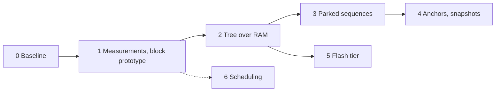

# Radix tree KV cache: high-level roadplan

This roadplan turns the design in [design.md](../design.md) into phases. Each phase has a plan file, which says exactly what to build and measure, and a results file, which records what the phase showed. Each phase ends with a rerun of the Phase 0 matrix, so every change is measured against the same baseline.

## Phases

The order puts measurements first, then the tree over RAM, then sharing in the KV pool, then the features that need a working tree. Each code change sits behind a server flag, so the stock behavior stays available as a baseline.

| Phase | Name | Plan | Results | Status |
| --- | --- | --- | --- | --- |
| 0 | Baseline | [plan](phase_0_baseline.md) | [results](phase_0_baseline_results.md) | done |
| 1 | Measurements and block prototype | [plan](phase_1_measurements.md) | [results](phase_1_measurements_results.md) | done |
| 2 | Tree over RAM with block storage | [plan](phase_2_ram_tree.md) | [results](phase_2_ram_tree_results.md) | planned |
| 3 | Parked sequences and stateless slots | [plan](phase_3_parked_sequences.md) | [results](phase_3_parked_sequences_results.md) | planned |
| 4 | Anchors and snapshot policy | [plan](phase_4_anchors_snapshots.md) | [results](phase_4_anchors_snapshots_results.md) | planned |
| 5 | Flash tier | [plan](phase_5_flash_tier.md) | [results](phase_5_flash_tier_results.md) | planned |
| 6 | Scheduling | [plan](phase_6_scheduling.md) | [results](phase_6_scheduling_results.md) | planned |

*Phase 5 needs only the tree over RAM, not Phase 3 or 4. Scheduling (Phase 6) is independent and can start any time after Phase 1.*

## What each phase delivers

One sentence per phase, so the whole path is visible at once. The plan files have the details.

- **Phase 0, baseline (done).** The orchestration benchmark, builds for the laptop and the phone, and a 6-configuration baseline that found BUG-001, the eviction cliff, and the hybrid and SWA reuse losses.
- **Phase 1, measurements.** The restore-vs-recompute costs and thresholds \(T_1\) and \(T_2\) per device and model, a working block save and restore with existing library calls, a block size `B`, results for the upstream BUG-001 fixes, and cache telemetry in the server.
- **Phase 2, tree over RAM.** A radix tree with block storage replaces the flat RAM prompt cache. Slots still own the KV pool. This alone fixes reuse when a slot is overwritten (config F) and when the RAM cache is too small for whole states (config D).
- **Phase 3, parked sequences.** The tree also owns prefixes in the KV pool, under parked sequence IDs, and slots become stateless. Any slot can attach any cached prefix with `seq_cp`, so BUG-001 cannot happen.
- **Phase 4, anchors and snapshots.** Clients can mark the end of a system prompt, and the server places recurrent and SWA snapshots on a grid and at anchors, so Gemma and LFM2 can resume after shared prefixes.
- **Phase 5, flash tier.** Blocks spill to flash files, so prefixes survive a server restart and the phone can keep more than its RAM holds.
- **Phase 6, scheduling.** Lane reservation and batch priority, so a background task does not delay the foreground stages (Phase 0: stage-1 time to first token on the phone went from 1.0 s to 5.2 s).

## Decisions that hold across phases

These were settled in [design.md](../design.md). Changing one of them means updating the design first.

| Decision | Choice | Where it is argued |
| --- | --- | --- |
| Index | Radix tree with exact splits | design.md, "Trie vs radix tree" and "Node granularity" |
| Storage in RAM and flash | Fixed blocks of `B` tokens at multiples of `B` | design.md, "Node granularity" |
| Ownership | The tree owns prefixes; slots borrow them | design.md, "Overview" |
| Data | Immutable nodes; no write-back protocol | design.md, "Nodes" |
| Eviction | Bottom-up per tier, ranked by priority, hits with aging, then recency | design.md, "Eviction" |
| Pruning | Drop a lower-tier leaf when its run is below \(T_t\) | design.md, "Pruning short runs" |
| Restore rule | Restore a run when it is longer than \(T_t\) | design.md, "Restore or recompute" |

## Tracks next to the phases

The phases build the system. Two tracks decide what leaves the fork and what becomes a paper.

**Upstream track.** llama.cpp takes small, separate changes, and a new subsystem needs an issue and maintainer agreement first. The tree stays in this fork until it has results. Candidates to send upstream, each on its own and each written and submitted by the contributor:
- test results for the BUG-001 fixes ([#30866](https://github.com/ggml-org/llama.cpp/pull/30866), [#28992](https://github.com/ggml-org/llama.cpp/pull/28992)), as comments on those PRs;
- a block state call (load many blocks in one call), if Phase 1 shows the per-call overhead matters;
- cache telemetry in the server.

**Research track.** The mechanisms are close to published work (SGLang HiCache, RAGCache, KVFlow, Marconi, Cake). The likely contribution is a measurement study on edge devices: a discrete GPU against a phone, attention, SWA, and hybrid models, time and energy per turn, what stock llama.cpp loses, and what the tree recovers. Needed comparisons:
- stock llama.cpp, configs A-F (Phase 0);
- SGLang with HiCache on the laptop (Phase 2 or later);
- a stage-ordering policy like KVFlow's, as a variant of the eviction ranking (Phase 3 or later).

## How a phase is run

Every phase follows the same steps, so results stay comparable.

1. Write or update the phase plan; agree on scope before writing code.
2. Build behind a flag. Run the repo's tests, linters, and type checks.
3. Rerun the Phase 0 matrix (or the subset the plan names) with the flag on and off.
4. Write the results file: numbers, what changed against Phase 0, what was learned, and what changes in later plans.
5. Update this file's status column and, if a decision changed, [design.md](../design.md).
