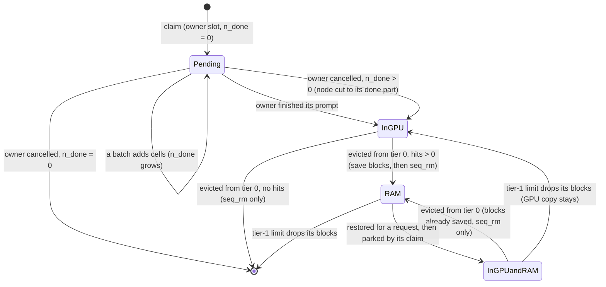
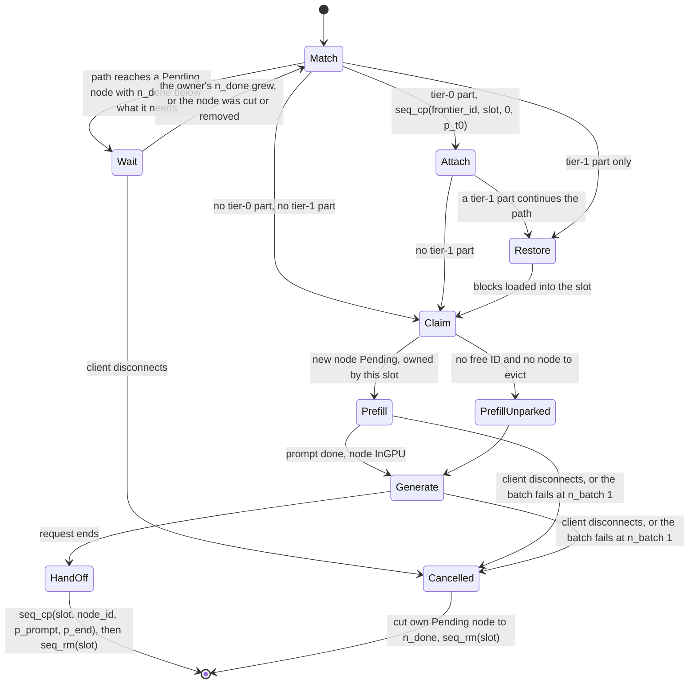
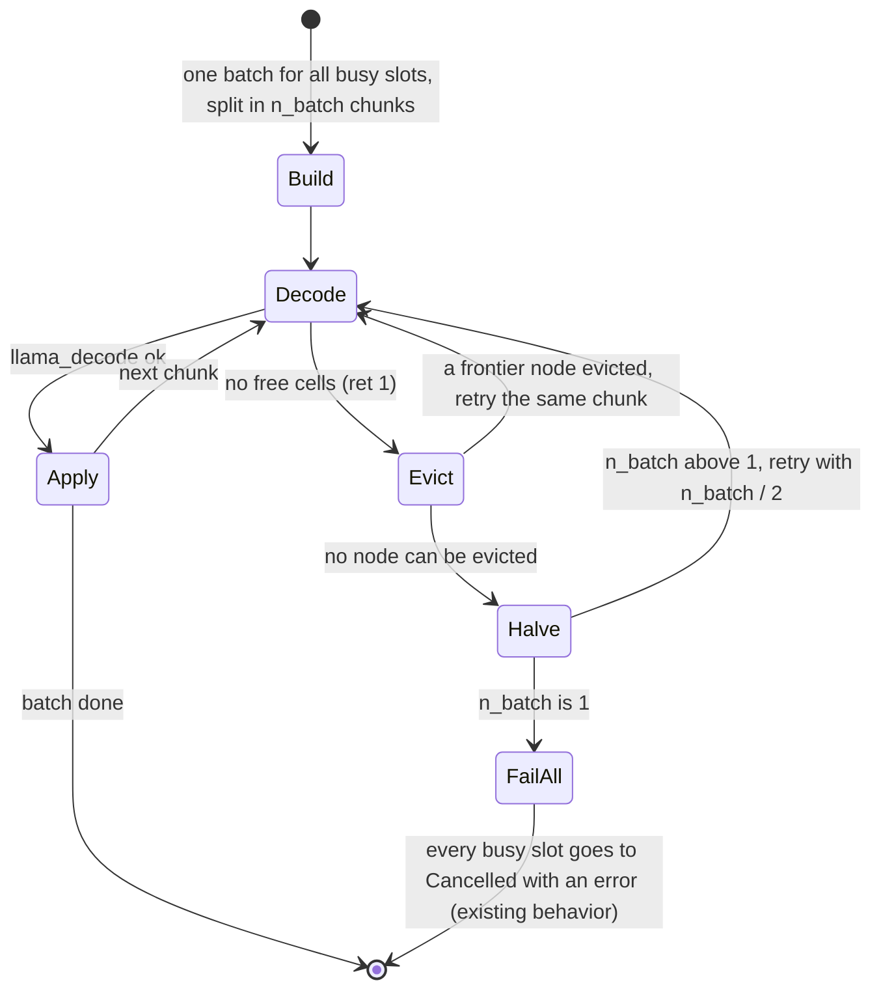
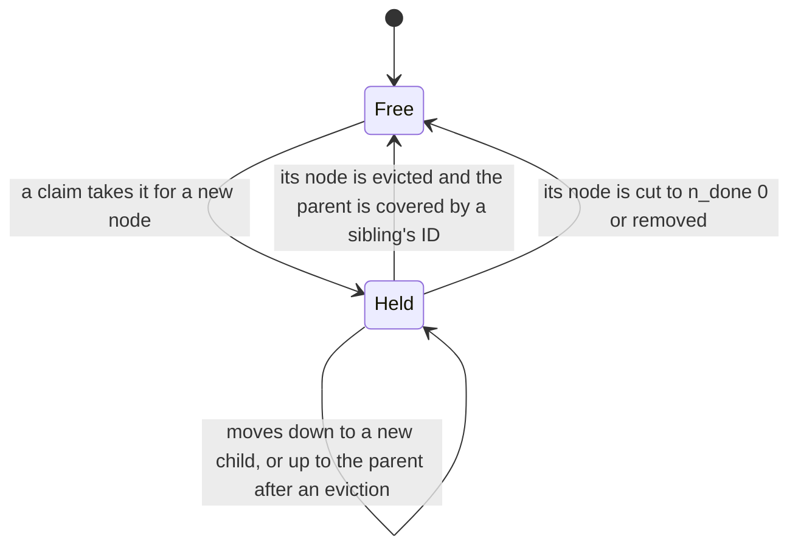

# Phase 3 plan: parked sequences and stateless slots

Phase 3 extends the tree into the KV pool (tier 0). Cached prefixes stay in the pool under parked sequence IDs that no slot uses, any slot attaches them with `seq_cp`, and slots hold nothing between requests. Results go in [phase_3_parked_sequences_results.md](phase_3_parked_sequences_results.md).

## Goal

What this phase must make true.

- Any slot serves any request at the same cost, so slot choice no longer decides hits.
- BUG-001 cannot happen: there is no "empty slot" whose cache is skipped.
- Attaching a prefix that is already in the pool costs a tag change, not a copy (laptop stage 1 TTFT near config C's 19 ms, against A's 104 ms).

## Scope

Full-attention models, as in Phase 2. Hybrid and SWA models follow in Phase 4.

## Design

How cells, tree nodes, parked IDs, and requests relate. The state machines below are the reference for the code and the tests: each scenario in the table must be a path through them.

The parts depend on each other in this order: rule U says what must stay true for every sequence; ownership says who creates cells; rule F says which nodes hold IDs, so that the library keeps the cells of every tier-0 node; write-back says when tier 1 gets data.

### Cells and tags

The KV pool is a row of cells. A cell holds the K/V of one token at one position, and a set of tags (sequence IDs). A sequence's attention reads every cell that has its tag.

- `seq_cp(src, dst, p0, p1)` adds tag `dst` to the cells that have tag `src` and a position in `[p0, p1)`. Within one stream (`--kv-unified`), no data moves.
- `seq_rm(id, p0, p1)` removes tag `id` from those cells. A cell with no tag is free.
- A token in a batch can have several sequence IDs (`common_batch_add` takes a list). Its new cell gets all of them.

**Rule U (unique): a sequence has at most one cell per position.** With two cells at one position, attention reads that token twice and the output changes with no error. Every operation below keeps rule U.

### Ownership: the tree owns parked cells

A request does not hand its cells to the tree at the end. It claims a tree node at the start, and the new prompt tokens are decoded with two tags, `{slot_id, node_id}`, so the tree owns each cell from the moment it is computed. At the end, only the generated tokens get the node's tag.

A node that a slot is still computing is **pending**. It records its owner slot and `n_done`, the number of its positions with cells. A second slot whose match reaches a pending node waits until the positions it needs are done, then attaches them. So two slots never compute the same prefix, and no ID can get two cells at one position.

**Rule W (wait): a slot never holds a claim while it waits.** It matches, waits if it must, matches again, and only then claims its own new part. A waiting slot owns nothing, so waits cannot form a cycle.

The server runs all slots on one thread: HTTP threads only queue tasks, and one loop builds the batch and calls `llama_decode`. So every tree operation is atomic. What is concurrent is that a request spans many loop iterations, and other requests start between them.

### Parked IDs live on the tier-0 frontier

The library keeps a cell only while some sequence ID tags it, and it knows nothing about the tree. So each tier-0 node needs an ID that tags its cells, and IDs are few (`n_seq_max` is at most 256). Giving every tier-0 node its own ID runs out fast: a 40-turn chat is a chain of 40 nodes. Giving IDs only to leaves loses shared prefixes: a leaf can be in tier 1 while its parent is in tier 0, and then no ID keeps the parent's cells. The frontier is the smallest set of IDs that keeps exactly the tier-0 nodes.

A node is in tier 0 when its whole path has cells in the pool. The **frontier** is the set of deepest tier-0 nodes, one on each branch that has tier-0 nodes. It is not one path, and it is not the set of leaves.

**Rule F (frontier): a node holds a parked ID if and only if it is in tier 0 and no descendant is.** The ID tags the cells of the node's whole path from position 0. An ancestor's cells carry the ID of each frontier node below it, but the ancestor does not hold an ID.

- **A child is added below a frontier node** (a chat grows): the ID moves down to the child. The child's new cells get the tag at decode time.
- **A frontier node is evicted:** `seq_rm(id, node.p0, -1)` frees only its own run. If the parent has no other tier-0 descendant, the ID moves up to the parent, which becomes frontier. If it has one, the ID is freed, because the sibling's ID still tags the parent's cells.
- **A node is split:** the head keeps `p0`, the tail takes the ID (if any), the owner, and its part of `n_done`.

Example: S is a shared system prompt (positions 0-1023) with one child T, a stage 3 tail (positions 1024-3999) that holds ID 11. Evicting T frees positions 1024-3999 only, and ID 11 moves to S. With IDs only on leaves, `seq_rm(11)` would also free S, which was never saved to RAM under write-back.

### Tier 1 is write-back

A request saves nothing to RAM. A node's blocks are saved when it is evicted from tier 0, and only if its aged hit count is above 0 and its run is at least \(T_1\). A node that no request matched after it was created (for example a stage 3 tail with one-off RAG documents) is dropped. Phase 2 saved on every request (77 ms per turn on the laptop, before the next request starts), and most of these saves were never used.

Tier 1 keeps its own byte limit (`--cache-ram`) and its Phase 2 eviction. Write-back adds bytes to tier 1, so it can evict blocks of other nodes there. Such a node can still be in tier 0, because the two tiers are evicted independently.

### State machine 1: a tree node

Where a node's K/V is. Eviction from tier 0 is one step on the server thread (save if needed, then `seq_rm`), so a node is never "saved but not yet freed" when another step runs.

- Only frontier nodes are evicted from tier 0. An inner tier-0 node leaves tier 0 when its last tier-0 descendant does.
- `InGPUandRAM` is reached only by a restore. A node in `InGPU` goes straight to `RAM` (or is dropped) when it is evicted, so the two states do not cycle.
- A `Pending` node is never evicted: its owner slot also tags its cells, so eviction would free nothing.

### State machine 2: a request on a slot

Prefill and Generate both call `llama_decode`, which is the one llama.cpp call for prompt and generated tokens. Eviction is not a slot state: a full pool fails the whole batch, which can hold prompt tokens of some slots and generated tokens of others (state machine 3).

- **Claim** also handles the path the slot got from tier 0 and tier 1: `seq_cp(slot, node_id, 0, p_have)` gives the new node's ID the whole path. All these cells are the slot's own and unique, so rule U holds.
- **PrefillUnparked** runs a request without caching it: its cells have only the slot's tag and are freed at the end.
- **HandOff** tags only the generated tokens that have cells. A sampled token that was never decoded has no cell (the Phase 2 cap).

### State machine 3: one batch in the server loop

What happens when `llama_decode` fails. This replaces `try_clear_idle_slots()`, which purges a whole idle slot with no write-back.

- `llama_decode` checks that all micro-batches of a chunk fit before it computes, so a failed call changes nothing and costs one cell scan.
- Evict picks the lowest-ranked frontier node (Phase 2 ranking) and runs state machine 1. A node that shares most cells with other paths frees only its tail, so the loop can evict several nodes for one chunk.
- A node that a running slot attached can be evicted. Its cells stay, because the slot tags them, so this frees nothing but breaks nothing. At claim or hand-off the slot's cells are then the only copy. A rule that skips such nodes is an efficiency change, left until measurements show useless evictions.

### State machine 4: a parked ID

When a claim finds no free ID, it evicts a frontier node from tier 0 to free one. If no node can be evicted, the request runs as PrefillUnparked.

### Scenarios

Each scenario is a test. The path column names the states of state machine 2 unless it says otherwise.

| # | Scenario | Path | Check |
| --- | --- | --- | --- |
| 1 | Cold prompt, one slot | Match, Claim, Prefill, Generate, HandOff | node InGPU, the slot's tag gone |
| 2 | Full tier-0 hit | Match, Attach, Claim, Generate, HandOff | no prefill, cells shared |
| 3 | Hit ends inside a node | Attach `[0, p)`, split at p, Claim the branch | rule U for both IDs |
| 4 | Tier-0 prefix, then tier 1 | Match, Attach up to the block boundary below `p_t0`, Restore, Claim | rule U across the boundary |
| 5 | Tier-1 prefix only | Match, Restore, Claim | Phase 2 restore, then parked |
| 6 | Two slots, same new prompt | slot 1 claims; slot 2 Waits, then Attaches | one copy, slot 2 prefills nothing |
| 7 | Two slots, shared prefix, different tails | slot 2 Waits until `n_done >= p_div`, splits, claims its tail | the head is done when it is split |
| 8 | A slot's attached node is evicted mid-request | state machine 3 Evict frees nothing | rule U, request unchanged |
| 9 | The owner of a node that a slot waits on is cancelled | owner Cancelled, node cut; waiter back to Match | the waiter claims the rest |
| 10 | Owner cancelled mid-prefill, no waiters | node cut to `n_done` | the cut node can be attached |
| 11 | Pool full during a batch | state machine 3 Evict loop | Pending nodes never chosen |
| 12 | Pool full, nothing to evict | Halve, then FailAll | every busy slot gets an error, the tree stays consistent |
| 13 | No free ID at claim | evict a frontier node, else PrefillUnparked | the request still runs |
| 14 | Tier-1 limit drops a node that is also in tier 0 | state machine 1, InGPUandRAM to InGPU | GPU copy unchanged |
| 15 | Sampled token never decoded | HandOff tags decoded cells only | no position without a cell |
| 16 | A node is evicted from tier 0 after its child was | state machine 1 for each, at different times | each saves only its own blocks; the path restores in order |
| 17 | `/slots` erase, save, restore | erase acts as Cancelled; save and restore are off with the tree, like context shift | documented limit |

### Decisions

Settled in review on 2026-11-14.

- **Tier-0 match that continues in tier 1** (scenario 4). Tier-1 blocks start at multiples of `B`, but the tier-0 part can end inside a block, so attaching all of it and then restoring the block would give the slot two cells at the same positions. The slot attaches tier 0 only up to the block boundary below `p_t0`, then restores whole blocks from there with Phase 2's `restore(..., p_keep)`. The positions between the boundary and `p_t0` (at most `B`-1) are copied from RAM, not recomputed.
- **Two slots need the same prefix: wait** (rule W). The second slot does no prefill and attaches the owner's cells. This also lowers its TTFT: both prompts in one batch would make each prefill about twice as long. The other choice, computing again without parking, was rejected because it does the prefill twice.
- **A waiter resumes as soon as `n_done` covers the positions it needs**, not only when the owner's prompt is done. A waiter that diverges at position p then attaches `[0, p)`, splits the node at p, and claims its own tail while the owner continues.
- **Tier-1 blocks stay per node.** Evicting a node from tier 0 saves only the blocks it owns (the full blocks whose last token is in its run). Blocks saved earlier for its descendants are not merged or rewritten. The block that crosses a node boundary belongs to the child, so a parent restores its last positions from the child's first block (Phase 2 `match`). If the child is later evicted from tier 1 too, the parent loses those positions (at most `B`-1) and they are recomputed.

## Work items

The code changes, in build order. Each step has its tests before the next starts.

### 1. Attach check (done)

`kv-block-bench` checks `check_attach_prefix` (attach a parked prefix with `seq_cp`, prefill the rest) and `check_attach_parked` (remove the slot, then attach all of the parked prompt). Both are bit-identical on the laptop and the phone, at `B` 16 and 64.

### 2. Tree index

- Node fields: parked ID (or none), owner slot (or none), `n_done`. Rule F is kept by `insert`, `split`, and eviction.
- `--cache-tree-parked N` (default 32): `n_seq_max = n_parallel + 1 + N` (slots, scratch, parked IDs), within `LLAMA_MAX_SEQ` (256). Requires `--kv-unified`.
- Index tests in `tests/test-server-component.cpp`: rule F after insert, split, and evict; ID moves down and up; a Pending node is never evicted; a cut node keeps its done part; rule W (a waiter holds no claim).

### 3. Request lifecycle

State machine 2 in `server-context.cpp`. The slot's `prompt.tokens` is cleared after HandOff, and `get_available_slot` stops comparing slot prompts. Context shift and `--cache-reuse` stay off with the tree, because they move or delete cells by position and parked cells are shared.

### 4. Tier-0 eviction

State machine 3 in the decode failure path, in place of `try_clear_idle_slots()`. Measure the evictions per turn and the time a batch waits for them. If these waits show in TTFT or turn time, add an up-front step later: at request start, evict until the request's new cells (prompt tokens not attached, plus `max_tokens`) are free. That step needs a new library call that counts free cells, and the failure path stays as a fallback.

### 5. Relation to #30970

[#30970](https://github.com/ggml-org/llama.cpp/pull/30970) (`--slot-attach`) lets a slot attach another slot's prefix cells. It was still open on 2026-11-10, so this phase stays independent. A comparison with it on config E is optional, because it needs a second build of that branch.

## Measurements

Laptop, Llama, 3 reps: A, C, E, F with `--cache-tree --cache-tree-parked 32`, against Phase 0 and Phase 2. Also run A and F with `-c 8192` so the pool fills, to exercise tier-0 eviction (Phase 0 never filled it). One stage 3 prompt (about 4,300 tokens with the `desktop` preset) still fits.

Phone, Llama, 3 reps: A and F only, as a check that nothing gets worse. On the phone the KV pool is already in RAM, so Phase 3 removes only about 27 ms of saves and 12 ms of restores per turn, against a 20 s turn.

## Exit criteria

- E: background hit rate within 2 points of the ideal (40-52%).
- A with the tree: stage 1 TTFT on the laptop within 20% of C.
- Small `-c`: no request fails, and evicted nodes are restored from tier 1 when worth it.
- The attach checks are bit-identical. Exact greedy equality with C is not a valid test on a GPU (Phase 2 results). Against a run without prompt cache, outputs differ no more often than C's, by a paired sign test over 102 requests.
- Every scenario in the design table has a passing test.

## Risks

- **Fragmentation.** Shared cells stay at fixed indices while slots come and go. Watch `find_slot` failures with free cells left.
- **Parked ID memory for hybrid models.** Recurrent memory is sized by `n_seq_max`, so each parked ID reserves a state. Measure before enabling for LFM2 in Phase 4.
- **Waiting adds latency for the waiter** when the owner's prefill is slow (for example the owner shares its batch with many slots). Measure the wait time per request on config E.
