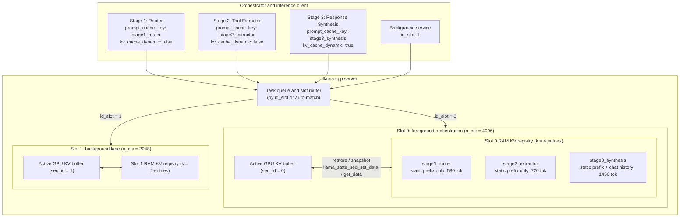
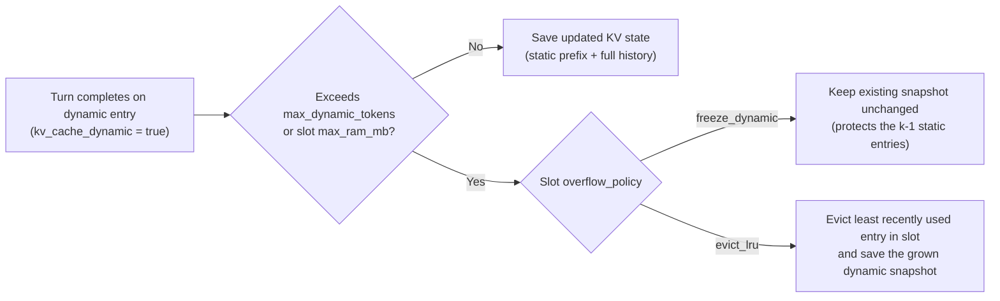
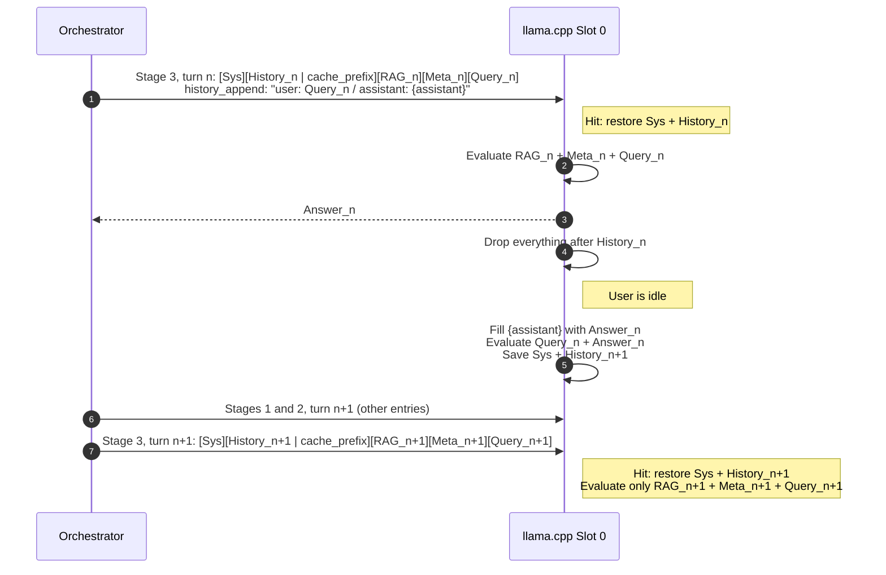

# Slot-Aware Multi-Entry KV Cache for Orchestration Workflows

## 1. Summary

This proposal adds a multi-entry KV cache to `llama-server` slots so that multi-stage orchestration workflows stop recomputing the same static prompts on every call.

The llama.cpp server is often used for orchestration workflows. One user turn passes through several stages, for example:

1. Stage 1: routing.
2. Stage 2: tool and argument extraction.
3. Stage 3: final response synthesis.

Each stage has its own, mostly static, prompt prefix. Background system tasks can also call the model on their own.

Today, each slot keeps one live KV cache that reflects its most recent request. When stages 1, 2, and 3 run one after another on the same slot, each call replaces the KV cache of the previous one. The static prompts and the conversation history are then recomputed on every turn.

This document proposes a **slot-aware multi-entry KV cache** that:

1. **Isolates workloads by slot.** Each slot can be configured on its own, for example slot 0 for foreground orchestration and slot 1 for background tasks, with its own context size and cache budget.
2. **Stops cache thrashing within a turn.** Each slot gets a registry of saved KV caches in host RAM. A slot can hold several precomputed caches (for example, \(k = 3\) or \(k = 4\)) and restore the matching one into GPU memory in milliseconds.
3. **Marks the exact prefix boundary with content blocks.** The client marks the end of the static text with `"cache_prefix": true` on a message content block, and can optionally name the entry with `prompt_cache_key`.
4. **Separates one-off stages from growing chat history (`kv_cache_dynamic`).** Routing and extraction stages (`kv_cache_dynamic: false`) keep only the static prefix. Synthesis stages (`kv_cache_dynamic: true`) keep `system prompt + chat history`, which grows every turn, and never keep the per-turn RAG documents, metadata, or query.
5. **Precomputes the next turn's history (`history_append`).** After a response, the server appends the new query and answer to the saved history while the user is idle, so the next turn only computes the RAG documents, metadata, and query.
6. **Reports cache telemetry.** The completion response includes cache hit status, token positions, and timing.

Saved prefixes can be stored as byte snapshots in host RAM, or, on unified-memory devices, as "parked" sequences that share KV cells with the working slot without any copy (section 4.6).

---

## 2. Problem Statement

This section describes how slots cache prompts today and why that does not fit multi-stage orchestration.

### 2.1 How llama.cpp slots work today

In `llama-server`, a **slot** (`server_slot`) is one logical inference session. The server creates `n_parallel` slots and divides the total context window between them (`n_ctx_slot = n_ctx / n_parallel`).

Each slot tracks:

- The token IDs of the most recent request (`slot.cache_tokens`).
- The number of tokens currently in the KV cache (`slot.n_past`).

When a request arrives with `"cache_prompt": true`, the server compares the new tokens with `slot.cache_tokens` from index 0 and reuses the longest common prefix (LCP). All tokens after the first mismatch are discarded and recomputed.

### 2.2 Why this does not fit orchestration workflows

There are three gaps between the current behavior and orchestration workloads.

**Gap 1: multi-stage orchestration overwrites the slot within one turn.**

Suppose slot 0 runs a 3-stage orchestration graph:

1. **Call 1 (stage 1, router):** evaluates `System Prompt A + User Query`. Slot 0 now holds `System Prompt A`.
2. **Call 2 (stage 2, tool extractor):** evaluates `System Prompt B + User Query`. `System Prompt B` differs from `System Prompt A` from the first sentence, so the common prefix is near zero. Slot 0 discards `System Prompt A` and computes `System Prompt B` from scratch.
3. **Call 3 (stage 3, response synthesis):** evaluates `System Prompt C + Chat History + User Query`. Slot 0 discards `System Prompt B` and computes `System Prompt C + Chat History` from scratch.
4. **Next turn:** stage 1 runs again and discards stage 3's `System Prompt C + Chat History`. The slot gets a 0% cache hit rate across turns.

```mermaid
sequenceDiagram
    autonumber
    participant Orch as Orchestrator
    participant Slot0 as llama.cpp Slot 0 (single KV buffer)

    Note over Orch,Slot0: Turn 1: "What's the weather, and set a 3m timer"
    Orch->>Slot0: Stage 1 (router): [Sys_A + User_1]
    Note right of Slot0: Cold miss: computes Sys_A + User_1<br/>VRAM holds [Sys_A + User_1 + Out_1]

    Orch->>Slot0: Stage 2 (extractor): [Sys_B + User_1]
    Note right of Slot0: Thrash: Sys_B != Sys_A<br/>Discards Sys_A, computes Sys_B + User_1<br/>VRAM holds [Sys_B + User_1 + Out_2]

    Orch->>Slot0: Stage 3 (synthesis): [Sys_C + History + User_1]
    Note right of Slot0: Thrash: Sys_C != Sys_B<br/>Discards Sys_B, computes Sys_C + History<br/>VRAM holds [Sys_C + History + User_1 + Out_3]

    Note over Orch,Slot0: Turn 2: "Thanks, cancel the timer"
    Orch->>Slot0: Stage 1 (router): [Sys_A + User_2]
    Note right of Slot0: Thrash: Sys_A != Sys_C<br/>Discards Sys_C and the chat history
```



*Each stage replaces the previous stage's KV cache, so no stage ever reuses its own prefix.*

**Gap 2: caching the whole request wastes memory on one-off stages.**

In stage 1 (routing) and stage 2 (tool extraction), the user query and the model output are never reused in later turns. Only the static prefix (system instructions, schemas, and few-shot examples) is reusable. Keeping the dynamic user suffix and the generated tokens in the cache wastes memory.

**Gap 3: no visibility into cache hits.**

The OpenAI-compatible chat response reports `prompt_tokens`, `completion_tokens`, and `total_tokens`, but not the number of cached tokens or the cache hit status. Developers cannot check whether KV caching works.

### 2.3 Motivating example: response synthesis with RAG

In a realistic synthesis stage, the reusable part of the prompt grows every turn while the part after it changes every turn. Saving the whole request is then both wasteful and often useless.

A typical stage 3 prompt has this layout:

```
[System prompt][Chat history][RAG documents][Metadata: time, location][User query] -> Answer
```

Turn \(n\) and turn \(n+1\) look like this:

```
Turn n:    [Sys][History_n                    ][RAG_n  ][Meta_n  ][Query_n  ] -> Answer_n
Turn n+1:  [Sys][History_n + Query_n + Answer_n][RAG_n+1][Meta_n+1][Query_n+1] -> Answer_n+1
```

Two facts follow:

1. **Only `Sys + History_n` is reusable.** The RAG documents differ on most turns, and the metadata and query differ on every turn.
2. **`Query_n` and `Answer_n` can never be reused from turn \(n\)'s KV cache.** In turn \(n\) they were computed after `RAG_n`, so their KV vectors depend on those documents. In turn \(n+1\) they sit directly after `History_n`, without the documents. They must be recomputed every time, however the cache is built.

The useful saved state is therefore "everything up to the end of the history". It grows every turn, and everything after it must be dropped every turn.

The existing RAM prompt cache saves the full slot state and skips any entry whose matching prefix is less than 25% of the entry's length (`server_prompt_cache::load`). Because stages 1 and 2 run between stage 3 calls, stage 3's state is always restored from RAM, so this rule applies on every turn. Example with Sys 500, RAG 3000, Meta 50, Query 30, and Answer 300 tokens, using Phi-4-mini with a `q8_0` KV cache (about 68 KiB per token):

| Turn | History | Reusable prefix | Full saved state | Matching fraction | Result |
| --- | --- | --- | --- | --- | --- |
| Early | 200 tok | 700 tok, 47 MiB | 4080 tok, 271 MiB | 0.17 | miss |
| Later | 1500 tok | 2000 tok, 133 MiB | 5380 tok, 357 MiB | 0.37 | hit, but 63% of the entry is waste |

*Large RAG blocks push early turns below the 25% rule, and later turns store mostly documents that are never reused.*

### 2.4 Why this matters more on edge devices

On devices with little memory and slow prefill, the cost of a miss is higher and the cache budget is smaller.

- **Prefill is slow.** A 700-token prefill that takes about 50 ms on a desktop GPU can take seconds on a phone CPU or NPU. Reliable hits are worth more.
- **Small cache budgets have a cliff.** The stages run in a fixed cycle (1, 2, 3, 1, ...), and the existing cache evicts the oldest entry first. If the entries are even slightly larger than the budget, each stage's entry has just been evicted when it is needed, and the hit rate can drop to near 0%. Prefix-only entries can be the difference between all hits and almost none.
- **Hybrid and SWA models are common on edge.** Models such as LFM2 (partly recurrent) and Gemma 3 (sliding-window attention) cannot roll their state back to an arbitrary position. A prefix that ends inside a message can only be reused if a checkpoint is created at that boundary.
- **Static prefixes can be stored on flash.** Mobile operating systems often stop apps. Prefix-only entries do not change between runs, so they can be saved to storage and loaded at startup. Full-state entries contain one specific query and are not useful to store.

Boundary marking does not reduce the live KV buffer. The buffer is allocated for the full `n_ctx` when the context is created, and trimming frees cells inside it, not memory. The savings are in the saved entries only.

---

## 3. High-Level Proposed Solution

The slot stays the unit of execution on the GPU. This section adds seven capabilities to it.

### 3.1 Individually configurable slots

At startup, the server accepts a per-slot configuration list instead of one equal `n_ctx / n_parallel` split:

- **Slot 0 (foreground orchestration):** a large context window (for example, 4096 tokens) and a cache registry that holds up to \(k\) KV caches.
- **Slot 1 (background tasks):** a smaller context window (for example, 2048 tokens), so background calls can run at the same time without evicting the foreground caches.

Clients select a slot with `"id_slot": 0`, or omit `id_slot` to let the server pick a free slot.

### 3.2 Multi-entry KV cache registry per slot (host RAM <-> GPU VRAM)

Each slot can keep up to \(k\) saved KV cache entries in host RAM. Entries are saved and restored with the sequence state API (`llama_state_seq_get_data` and `llama_state_seq_set_data`).

- When stage 1, 2, or 3 runs on slot 0, the server finds the matching entry (by `prompt_cache_key`, or by longest token-prefix match) and restores its KV tensors into slot 0's VRAM.
- Copying a 500 to 1,000 token KV snapshot from host RAM to VRAM is expected to take about 1 to 2 ms. This saves 50 to 300 ms of prefill on every stage call.

### 3.3 Explicit prefix boundary with content blocks (`"cache_prefix": true`)

Prompts often mix static instructions with dynamic values such as the current time, device state, or user input. Instead of guessing where the static text ends, or using fragile character offsets, the client writes the message `"content"` as an ordered array of text blocks and sets `"cache_prefix": true` on the last static block:

- Everything from token 0 of the formatted prompt to the end of the marked block is the static, cacheable prefix.
- Everything after the marked block is the dynamic suffix of the current request.

### 3.4 Static prefix caching vs. dynamic session caching (`kv_cache_dynamic`)

Each request states how the slot updates its saved entry after generation.

**`"kv_cache_dynamic": false`** (default; for routing, classification, and extraction stages):

- **Cold miss:** the server evaluates the full prompt (static prefix + dynamic suffix) in one prefill, so time to first token (TTFT) does not increase. After the last output token is sent, the server removes the dynamic suffix from the KV cache (`seq_rm`) and saves only the static prefix in the registry.
- **Warm hit:** the server restores the static prefix, evaluates only the dynamic suffix, returns the response, and leaves the saved entry unchanged.

**`"kv_cache_dynamic": true`** (for multi-turn response synthesis, see section 2.3):

The `cache_prefix` block marks the end of the chat history. The prefix is `Sys + History`, and it grows every turn. Everything after it (RAG documents, metadata, query, answer) is dropped after every turn.

- **Turn \(n\):** restores the saved `Sys + History_n` (or computes it on a miss), evaluates `RAG_n + Meta_n + Query_n`, and generates `Answer_n`. After the last token, it drops everything after `History_n`.
- **Without `history_append`:** the saved entry stays `Sys + History_n`. Turn \(n+1\) reuses it and computes `Query_n + Answer_n` as part of its new history, followed by `RAG_n+1 + Meta_n+1 + Query_n+1`. The server then replaces the entry with the longer prefix `Sys + History_n+1`.
- **With `history_append` (section 3.6):** the server computes `Query_n + Answer_n` right after the response, while the user is idle. Turn \(n+1\) then only computes `RAG_n+1 + Meta_n+1 + Query_n+1`.
- **New conversation:** the server compares the new prompt with the saved entry, finds that only `Sys` matches, drops the old history, and continues from the system prompt.

`Query_n` and `Answer_n` are always recomputed in the history position. Their KV vectors from turn \(n\) depend on `RAG_n` and cannot be reused.

### 3.5 Memory limits and overflow policies

A dynamic entry grows every turn. Each slot's registry therefore has limits (`max_entries`, `max_ram_mb`, `max_dynamic_tokens`) and an `overflow_policy`:

| Policy | Behavior |
| --- | --- |
| `freeze_dynamic` | Stops growing the dynamic entry when it reaches `max_dynamic_tokens` or the RAM limit. The static entries of stages 1 and 2 are never evicted. |
| `evict_lru` | Lets the dynamic entry grow up to the slot's context limit. When memory runs low, evicts the least recently used entry in the slot's registry. |

### 3.6 Precomputing the next history prefix (`history_append`)

The next turn's history is `History_n + Query_n + Answer_n`. The server knows `Answer_n` as soon as generation ends, so it can compute this extension before the next request arrives.

The server does not know how the client formats its history (XML tags, bullet lists, markdown, and so on). The client therefore sends a template for the new history entry in a separate request field, `history_append`. The template has one placeholder, `{assistant}`:

```json
{
    "history_append": "user_2: actually make it 15m\nassistant_2: {assistant}\n"
}
```

After the response is sent, the server:

1. Fills `{assistant}` with the final `message.content` as returned to the client. This excludes reasoning content and parsed tool calls, so the text matches what the client will put into its history.
2. Appends the filled text to the saved `Sys + History_n` prefix, directly after the `cache_prefix` block.
3. Evaluates only the appended tokens and saves the result as `Sys + History_n+1`.

On the next turn, the client sends its history with the new entry rendered with exactly the same bytes. The server still checks the token prefix (LCP), so a client that renders the entry differently gets a partial hit, not a wrong result.

Rules:

- **Opt-in.** The work uses compute and energy while the user is idle. On battery-powered devices this must be the caller's choice.
- **Never blocks a new request.** The server runs the extension in small chunks and stops when a new task arrives for the slot. Partial progress is still reused through the LCP. If the queue is not empty when the response ends, the server skips the extension.
- **Wasted work is acceptable.** If the user edits or regenerates the previous message, the precomputed entry no longer matches and the LCP stops before it.

**Rejected alternative: in-band template.** An earlier version put the template inside the prompt text, between `{{` and `}}`, with an `{{assistant}}` placeholder. The block then also marked the history boundary. This was dropped for three reasons:

- `{{` and `}}` can appear in real content (code, JSON, templates in RAG documents). A RAG document or user message that contains them could change caching behavior on purpose (prompt injection).
- The server must remove the block from the current prompt before the turn runs, or the model sees `{{assistant}}` in its context.
- The client must copy the query into the block by hand. Any difference from the real query causes a silent cache miss.

A `{user}` placeholder, filled from a separate `query` field, could remove the copy step from `history_append` as well.

**Client-side version available today.** A client can get most of this benefit without server changes. After it receives `Answer_n`, it sends a request to the same `id_slot` with `max_tokens: 1` and the messages `[system, user: History_n+1]`, with no RAG documents, metadata, or query. The next real stage 3 request then matches `Sys + History_n+1`. The warm request ends with a few end-of-turn tokens that the real request does not match; these are simply discarded. The cost is one extra request, and one wasted RAM cache entry: the server saves the previous full stage 3 state (including RAG documents) when the warm request arrives.

### 3.7 Where saved prefixes live: RAM snapshots or parked sequences

A saved prefix can be stored in two ways. The right choice depends on the hardware.

| Storage | How it works | Best for |
| --- | --- | --- |
| RAM snapshot | `llama_state_seq_get_data` copies the K/V bytes of the prefix into a host buffer. `llama_state_seq_set_data` copies them back on restore. | Discrete GPUs with little VRAM. Inactive prefixes move out of scarce VRAM, at the cost of a PCIe copy per stage switch. |
| Parked sequence | The prefix stays in the KV cache under its own sequence ID. Before a stage runs, `llama_memory_seq_cp` shares its cells with the working slot. No K/V bytes move. | Unified-memory devices (Apple Silicon, Jetson, phones, integrated GPUs). There, "RAM" and "VRAM" are the same memory, so a snapshot frees nothing and only adds copy time, bandwidth, and energy. |

Section 4.6 walks through parked sequences step by step.

---

## 4. Detailed Architecture and Execution Flows

This section shows how requests reach slots and registries, and how each cache mode runs.

### 4.1 Architecture



*Each slot has one active KV buffer in VRAM and its own registry of saved entries in host RAM.*

### 4.2 Cold start: single prefill, then suffix trim (`kv_cache_dynamic: false`)

Self-attention is causal, so evaluating the static prefix and the dynamic suffix in one batch produces the same KV vectors for the prefix as evaluating the prefix alone.

On a cold miss, the server therefore does not split the prefill into two steps:

1. It finds the static prefix boundary and records `n_static_tokens` (for example, 500).
2. It runs one prefill over all tokens and starts decoding immediately. TTFT has no extra overhead.
3. After the last token is sent, it removes positions 500 and above from the slot's KV cache (`llama_memory_seq_rm(mem, slot.id, 500, -1)`) and saves positions 0 to 499 in the slot's registry.

### 4.3 Warm turns

After the caches are populated, each later user turn runs all three stages on slot 0 without recomputing any static prefix and without losing stage 3's conversation history.

### 4.4 Memory management and overflow policies

When a slot's registry holds \(k\) entries and a `kv_cache_dynamic: true` entry grows over many turns, the server applies the slot's `overflow_policy`:



### 4.5 Synthesis turn with RAG and `history_append` (`kv_cache_dynamic: true`)

This flow shows one stage 3 turn and the idle-time extension that prepares the next one.



*The cost of each turn stays flat as the conversation grows: the history is never recomputed on the critical path.*

Dropping everything after `History_n` needs a rollback point at the boundary. For SWA, recurrent, and hybrid models, the server must stop the prefill batch at the `cache_prefix` boundary and create a checkpoint there (see section 7.3, item 1).

### 4.6 Parked prefixes in the unified KV cache

This section explains how a prefix can be shared with a working slot without copying any K/V data, and what already exists in llama.cpp.

Two different things are called "unified":

- **llama.cpp's unified KV cache** (`--kv-unified`) is a software layout: all sequences share one KV buffer. `llama-server` turns it on by default.
- **Unified-memory hardware** means the CPU and GPU share the same physical RAM.

Zero-copy sharing depends only on the first. The hardware only decides whether parking or RAM snapshots is the better choice (section 3.7).

**Step 1: what the KV cache is.** The KV cache is one large buffer allocated at startup and divided into `n_ctx` cells. Each cell holds one token's K and V vectors for every layer. Each cell also has metadata: its position and the set of sequence IDs that own it. Each server slot is one sequence ID. A sequence only attends to cells tagged with its own ID.

**Step 2: one cell can belong to several sequences.** With `--kv-unified`, all sequences take cells from one pool, and a cell can carry several sequence IDs. `seq_cp(src, dst)` copies no K/V data; it only adds `dst` to the tags of every `src` cell (`llama_kv_cache::seq_cp`, `src/llama-kv-cache.cpp:521`). `seq_rm(seq)` removes that sequence's tag. A cell is freed only when no sequence owns it (`llama_kv_cells::seq_rm`, `src/llama-kv-cells.h:281`).

**Step 3: parking a prefix.** The stage 3 prefix gets its own sequence ID (here 10) that never generates text. With 2000 tokens of `Sys + History`:

```
Park:          cells 0-1999      tags {10}         (seq 10 = parked prefix)

Stage 3 runs on slot 0:
  seq_cp(10 -> 0)
               cells 0-1999      tags {10, 0}      (no K/V bytes move)
  evaluate RAG + Meta + Query + Answer for seq 0
               cells 2000-5379   tags {0}

After the request:
  seq_rm(0)
               cells 0-1999      tags {10}         (prefix stays)
               cells 2000-5379   tags {}  -> free
```

*Sharing the prefix is a metadata change. The prefix's K/V data is stored once and never moves.*

With `history_append`, the server appends `Query_n + Answer_n` to sequence 10 after the turn, so the parked prefix grows from `History_n` to `History_n+1`.

**Step 4: compare with RAM snapshots.** A RAM snapshot of the same 2000-token prefix with Phi-4-mini and a `q8_0` KV cache is about 133 MiB. It is copied out when stage 3's state is set aside, and copied back when it is restored, on every stage switch.

**What exists and what does not.**

- Exists: the unified KV cache (default in `llama-server`), metadata-only `seq_cp`, and its use in the server to share one slot's processed prompt with another (`copy_prompt_to()` and `copy_state_to()`, `server-context.cpp:848-859`).
- Does not exist: parked sequences. The server creates exactly one sequence per slot, and its prompt cache always uses byte snapshots. Parking needs extra sequence IDs beyond the slots; the library allows up to 256 (`LLAMA_MAX_SEQ`).

**Costs and limits.**

- Parked prefixes take KV cells permanently. `n_ctx` must cover all parked prefixes plus the largest working suffix. In the example, stage 3 needs 5380 cells at its peak, plus the parked prefixes of stages 1 and 2.
- `n_seq_max` must include the parked sequences.
- For recurrent and hybrid models, `seq_cp` copies the recurrent state. That state is small, so parking still works, but this should be tested.
- Compared with the existing RAM cache, parking does not save memory. The existing cache removes an entry from RAM when it restores it, so the active prefix is never stored twice. The gain is avoiding two copies per stage switch, roughly tens of milliseconds per turn on a phone. This is secondary to the gains from prefix-only entries and `history_append`.

---

## 5. API and Payload Specification

This section defines the startup configuration, the per-request fields, and the extended response.

### 5.1 Server and slot configuration (`create_api_instance` / `OptionParams`)

At startup, the orchestrator can pass a `"slots"` array to set each slot's context size, role, and cache registry. If `"slots"` is omitted, the server keeps the current behavior (`n_parallel` slots of `n_ctx / n_parallel` tokens each).

```json
{
    "n_ctx": 6144,
    "n_parallel": 2,
    "cache_type_k": "q8_0",
    "cache_type_v": "q8_0",
    "slots": [
        {
            "id_slot": 0,
            "role": "orchestration",
            "n_ctx": 4096,
            "kv_cache_config": {
                "enabled": true,
                "max_entries": 4,
                "max_ram_mb": 512,
                "auto_prefix_match": true,
                "overflow_policy": "freeze_dynamic",
                "max_dynamic_tokens": 3072
            }
        },
        {
            "id_slot": 1,
            "role": "background",
            "n_ctx": 2048,
            "kv_cache_config": {
                "enabled": true,
                "max_entries": 2,
                "max_ram_mb": 128,
                "auto_prefix_match": true,
                "overflow_policy": "evict_lru",
                "max_dynamic_tokens": 1536
            }
        }
    ]
}
```

**Slot configuration fields**

| Field | Type | Default | Description |
| --- | --- | --- | --- |
| `id_slot` | int | `0` to `n_parallel - 1` | Unique slot index. |
| `role` | string | `default` | Label for telemetry and debugging. |
| `n_ctx` | int | `n_ctx / n_parallel` | Maximum context window of this slot. |
| `kv_cache_config.enabled` | bool | `true` | Enables the multi-entry RAM KV cache registry for this slot. |
| `kv_cache_config.max_entries` | int | `4` | Maximum number of saved KV snapshots in this slot. |
| `kv_cache_config.max_ram_mb` | int | `512` | Maximum host RAM, in MiB, for this slot's saved snapshots. |
| `kv_cache_config.auto_prefix_match` | bool | `true` | If a request has no `prompt_cache_key`, search the slot's entries for the longest matching token prefix. |
| `kv_cache_config.overflow_policy` | string | `freeze_dynamic` | Behavior when a `kv_cache_dynamic: true` entry exceeds `max_dynamic_tokens` or `max_ram_mb`. See section 3.5. |
| `kv_cache_config.max_dynamic_tokens` | int | `0.75 * n_ctx` | Maximum token length of a `kv_cache_dynamic: true` entry when the policy is `freeze_dynamic`. |

### 5.2 Per-request payload

**Case A: system prompt with a static part and a dynamic part (stage 1, router).**

```json
{
    "id_slot": 0,
    "cache_prompt": true,
    "prompt_cache_key": "sha256:543266435234...",
    "kv_cache_dynamic": false,
    "stream": false,
    "n_predict": 128,
    "messages": [
        {
            "role": "system",
            "content": [
                {
                    "type": "text",
                    "text": "You are a stage 1 router. Classify the user request into one of ...",
                    "cache_prefix": true
                },
                {
                    "type": "text",
                    "text": "Current time: <time>. Active app: <app>."
                }
            ]
        },
        {
            "role": "user",
            "content": [
                { "type": "text", "text": "set a timer for 3m" }
            ]
        }
    ],
    "json_schema": {
        "type": "object",
        "properties": {
            "domain": { "type": "string" }
        },
        "required": ["domain"]
    }
}
```

**Case B: static prefix ends inside the user message (stage 2, tool extractor).**

```json
{
    "id_slot": 0,
    "cache_prompt": true,
    "prompt_cache_key": "sha256:9f1c0a7e5b21...",
    "kv_cache_dynamic": false,
    "stream": false,
    "n_predict": 256,
    "messages": [
        {
            "role": "system",
            "content": [
                { "type": "text", "text": "You extract ..." }
            ]
        },
        {
            "role": "user",
            "content": [
                {
                    "type": "text",
                    "text": "Available tools: ...",
                    "cache_prefix": true
                },
                { "type": "text", "text": "set a timer for 3m" }
            ]
        }
    ],
    "json_schema": {
        "type": "object",
        "properties": {
            "tool": { "type": "string" },
            "arguments": { "type": "object" }
        },
        "required": ["tool", "arguments"]
    }
}
```

**Case C: multi-turn synthesis with history, RAG documents, and metadata (stage 3).**

The history lives inside the user message, in the client's own format. The `cache_prefix` block ends the history. `history_append` tells the server how to extend it after the response.

```json
{
    "id_slot": 0,
    "cache_prompt": true,
    "prompt_cache_key": "orch_stage3_synthesis:conv_8f2a",
    "kv_cache_dynamic": true,
    "stream": true,
    "n_predict": 512,
    "messages": [
        {
            "role": "system",
            "content": "You are a helpful assistant ..."
        },
        {
            "role": "user",
            "content": [
                {
                    "type": "text",
                    "text": "<history>\nuser_1: set a timer for 3m\nassistant_1: OK, timer set for 3 minutes.\n",
                    "cache_prefix": true
                },
                {
                    "type": "text",
                    "text": "</history>\n<documents>\n...retrieved RAG documents...\n</documents>\ntime: 11:00 PM\nlocation: Chicago\nuser query: actually make it 15m"
                }
            ]
        }
    ],
    "history_append": "user_2: actually make it 15m\nassistant_2: {assistant}\n"
}
```

The cached block ends exactly where the next history entry goes, so the closing `</history>` tag is in the dynamic block. The filled `history_append` text then continues the cached prefix directly, and next turn the client renders the same bytes inside its history.

**Request fields**

| Field | Location | Description |
| --- | --- | --- |
| `id_slot` | request | Slot that runs the request. Omit to let the server choose. |
| `cache_prompt` | request | Enables KV cache lookup for the request. |
| `prompt_cache_key` | request | Optional name of the registry entry, such as a hash or a string ID. |
| `kv_cache_dynamic` | request | `false`: the prefix up to the `cache_prefix` boundary is static; save it once and keep it unchanged. `true`: the prefix is `Sys + History` and grows every turn; replace the saved entry with the new, longer prefix. In both cases, everything after the boundary is dropped. |
| `cache_prefix` | message content block | Marks the last block of the cacheable prefix. For `kv_cache_dynamic: true`, this is the end of the chat history. |
| `history_append` | request | Optional. Template for the new history entry, with an `{assistant}` placeholder. After the response, the server fills it with the final `message.content` and computes it on top of the saved prefix (section 3.6). Requires `kv_cache_dynamic: true`. |

### 5.3 Extended response payload (cache observability)

The response adds cache details to `usage`:

```json
{
    "id": "chatcmpl-98a4f2c1",
    "object": "chat.completion",
    "created": 1790000000,
    "model": "phi4",
    "choices": [
        {
            "index": 0,
            "finish_reason": "stop",
            "message": {
                "role": "assistant",
                "content": "..."
            }
        }
    ],
    "usage": {
        "prompt_tokens": 642,
        "completion_tokens": 8,
        "total_tokens": 650,
        "prompt_tokens_details": {
            "cached_tokens": 600,
            "evaluated_tokens": 42
        },
        "kv_cache": {
            "cache_hit": true,
            "cache_status": "hit_restored_from_ram",
            "id_slot": 0,
            "prompt_cache_key": "sha256:125432...",
            "kv_cache_dynamic": false,
            "static_prefix_positions": 600,
            "cached_positions_used": 600,
            "new_positions_evaluated": 42,
            "positions_retained_after_turn": 600,
            "restore_time_ms": 9.80,
            "prefill_time_ms": 21.4,
            "snapshot_save_time_ms": 0.0,
            "slot_entries_used": 3,
            "slot_entries_max": 4,
            "slot_ram_used_mb": 64.2
        }
    }
}
```

**`usage.kv_cache` fields**

| Field | Description |
| --- | --- |
| `cache_hit` | `true` if any cached positions were reused. |
| `cache_status` | Cache diagnostic, for example `hit_in_vram`, `hit_restored_from_ram`, or `miss`. |
| `id_slot` | Slot that ran the request. |
| `prompt_cache_key` | Registry entry used, if any. |
| `kv_cache_dynamic` | Echo of the request field. |
| `static_prefix_positions` | Token count from index 0 to the end of the `cache_prefix` block. |
| `cached_positions_used` | Number of prompt positions reused from the KV cache without recomputation. |
| `new_positions_evaluated` | Number of prompt positions evaluated in prefill (not generated tokens). |
| `positions_retained_after_turn` | Number of positions stored in the registry entry after the turn. |
| `restore_time_ms` | Time to copy KV state from RAM into VRAM. `0.0` if the state was already in VRAM, or on a miss. |
| `prefill_time_ms` | Time to evaluate the new positions. |
| `snapshot_save_time_ms` | Time to save or update the KV snapshot in host RAM after generation. |
| `slot_entries_used` / `slot_entries_max` | Current number of entries in the slot's registry vs. its capacity. |
| `slot_ram_used_mb` | Host RAM used by this slot's saved snapshots. |

---

## 6. Implementation Notes

These notes list the main implementation points and safety rules.

1. Compute `static_prefix_positions` while the chat template is applied, in `llama_server.cc`.
2. A slot invalidates its RAM snapshots when the model is reloaded, the LoRA adapters change, or the KV cache quantization settings change.
3. Run `history_append` as an internal task on the same slot after the response is sent. Process it in chunks of `n_batch` tokens and stop when a new task for the slot is queued.
4. Tokenize the `history_append` text together with the cached prefix text and evaluate only the tokens after the LCP. Tokenizing the appended text alone can give different tokens at the join.
5. Parked sequences (section 4.6) need sequence IDs beyond `n_parallel`, so `n_seq_max` must be raised when the context is created.

---

## 7. Review Against the Current Code

This section checks the claims above against the code in this repository (`tools/server`, `common`) and lists gaps and edge cases. File and line references are to the current tree.

### 7.1 Claim check

Several of the problem-statement claims do not hold for the current `llama-server`. The biggest one: a host-RAM prompt cache already exists and is enabled by default.

| Claim | Result | Evidence |
| --- | --- | --- |
| Slots split `n_ctx` equally (`n_ctx / n_parallel`). | partial | With default settings the server uses `n_parallel = 4` and `kv_unified = true` (`tools/server/server.cpp:127-130`). All slots then share one KV pool and each slot can use up to the full `n_ctx` (`n_ctx_slot()`, `server-context.cpp:5082`). The equal split applies only with `--no-kv-unified`. `--kv-unified-per-slot N` caps every slot to the same `N`. |
| Slot state is `slot.cache_tokens` and `slot.n_past`. | outdated | The cached tokens are `slot.prompt.tokens` (`server_prompt`, `server-task.h:686`). `n_past` is a local variable in `update_slots()`. |
| Reuse is the LCP from index 0; the rest is discarded. | true | `slot.prompt.tokens.get_common_prefix(...)` (`server-context.cpp:4116`). There is also `--cache-reuse N`, which reuses matching chunks after the LCP with KV shifting. |
| A slot only remembers the previous call, so the hit rate is 0%. | false | `--cache-ram` defaults to 8192 MiB (`common/common.h:644`). When a slot gets a dissimilar prompt, `get_available_slot()` saves the slot state to RAM and restores the cached entry with the best prefix match (`server-context.cpp:1863-1903`, `server_prompt_cache::load` in `server-task.cpp:1838`). In the stage 1/2/3 example, each stage's previous state is restored from RAM. |
| Stage 1 and 2 output and user suffix waste memory. | true | The RAM cache saves the full slot tokens, including the user suffix and generated output. |
| No visibility into cached tokens. | false | `usage.prompt_tokens_details.cached_tokens` exists (`server-task.cpp:362`), and `timings` has `cache_n`, `prompt_n`, and `prompt_ms`. `cached_tokens` also counts tokens restored from RAM, because `n_prompt_cached = n_past` is set after the restore (`server-context.cpp:4338`). What is missing: RAM-vs-VRAM source and restore/save times. |
| Snapshots use `llama_state_seq_get_data` / `set_data`. | true | The server uses the `_ext` variants with flags (`server-context.cpp:348-362`). It also saves the draft model state for speculative decoding; the registry must do the same. |
| A 500 to 1,000 token restore takes 1 to 2 ms. | optimistic | KV size per token is `2 x n_layer x n_head_kv x head_dim x bytes_per_element`. For Phi-4 (40 layers, 10 KV heads, head_dim 128) in F16 this is about 200 KiB per token, so 1,000 tokens is about 200 MiB. At a realistic 20 to 25 GB/s PCIe 4.0 rate, that is about 8 to 10 ms, plus serialization overhead (the state API copies through pageable memory). The example response in 5.3 already shows 9.8 ms. On unified-memory devices (Apple Silicon, integrated GPUs) the cost is a memory copy, not a PCIe transfer. |
| One prefill, then `seq_rm` of the suffix, gives a clean prefix. | partial | This is exact only for models with full KV removal. It fails for SWA models without `--swa-full` (positions older than the window are already gone) and for recurrent and hybrid models (Mamba, RWKV, Qwen3-Next, and others), whose state cannot be rolled back to an arbitrary position. The server already handles this with context checkpoints (`server-context.cpp:4412-4420`). |
| Per-slot `n_ctx`. | partial | `llama_context` has one `n_ctx_seq` for all sequences. With unified KV, a per-slot soft cap in the server is possible (like `--kv-unified-per-slot`, but per slot). With non-unified KV, different sizes need changes in `llama_kv_cache`. |
| `cache_prefix` on content blocks. | missing | `common/chat.cpp:375-391` keeps only `type` and `text` of each part and drops unknown keys. Text parts are then joined by the chat template, so the boundary is lost before tokenization. |
| Invalidate on model reload, LoRA change, KV type change. | partial | Model and KV type can change only at server restart, which clears RAM anyway. LoRA can change per request (`lora` field). The RAM cache entries are not tagged with the LoRA set, so the registry key must include it (see 7.3). |
| `create_api_instance`, `OptionParams`, `api_generate`, `api_chunked`, `llama_server.cc`. | external | None of these exist in this repository. They are from a wrapper outside llama.cpp. The proposal should state which layer it changes: the wrapper, or `llama-server` itself. |

### 7.2 Overlap with existing features

Most of the proposal can be built by extending current server features instead of adding a new subsystem. The llama.cpp contribution guide prefers this.

| Proposal item | Existing feature | Remaining gap |
| --- | --- | --- |
| Multi-entry RAM registry | `server_prompt_cache` (`--cache-ram`, `--cache-idle-slots`) | One global cache for all slots, no per-slot quota. Eviction removes the oldest entry first. An entry is moved out of RAM on restore and saved again on the next slot switch, so each switch pays a GPU-to-host copy. Entries with `f_keep < 0.25` are skipped. |
| `prompt_cache_key` | `POST /slots/{id}?action=save` and `action=restore` with a `filename` (`--slot-save-path`) | Disk-based and manual. No key in the completion request. |
| `cache_prefix` boundary | `message_spans` (`common/chat.h:178`) and checkpoints at user message starts (`server-context.cpp:4519`). `n_tokens_shared` stops prefill at a shared prefix for decision tasks (`server-context.cpp:4488`). | No boundary inside a message. No "save only the prefix" mode. |
| Cache telemetry | `usage.prompt_tokens_details.cached_tokens`, `timings`, `GET /slots` | No hit source, restore time, or registry state. |
| Slot isolation | `id_slot` on requests, `--slot-prompt-similarity` | No reserved slots, no per-slot memory budget. |
| `history_append` | A client-side warm request with `max_tokens: 1` (section 3.6) | Extra request, one wasted RAM cache entry per turn, and no way to stop the warm request when a real one arrives. |
| Parked sequences | Metadata-only `seq_cp` in the unified KV cache, used by `copy_prompt_to()` / `copy_state_to()` | No sequences beyond the slots; the prompt cache always uses byte snapshots. |

A smaller first step than the full proposal: (1) a per-request option that saves a prefix-only state to the existing `server_prompt_cache` at a message boundary, using the existing checkpoint logic so SWA and recurrent models work, and (2) keep that entry in RAM on restore (copy, not move). This covers gaps 1 and 2 without new configuration surface. Section 8 orders all the steps.

### 7.3 Edge cases the proposal does not cover

1. **SWA, recurrent, and hybrid models.** Section 4.2 assumes `llama_memory_seq_rm` can trim to any position. For these models it cannot. The fix is to stop the prefill batch at the boundary and create a checkpoint there, as the server already does at user message starts.
2. **Tokenization at the boundary.** Tokenizing the prefix alone can give a different token count than the same text inside the full prompt, because BPE merges can cross the boundary. The template also adds tokens around the content. The boundary must be found in the full tokenized prompt, or it must fall on a message or special-token boundary, like `message_spans`.
3. **Unstable chat templates.** Some templates insert the current date, remove the reasoning of earlier assistant turns, or render the last turn differently from earlier turns. If the history is kept as separate chat messages, the saved tokens (as generated) then do not match the re-rendered history, and the LCP stops at the previous assistant message. Re-tokenizing the generated text can also give different tokens than the ones sampled. The layout in section 2.3 avoids most of this: the history is plain text that the client renders, and the last answer is always recomputed from that text.
4. **Several conversations share one key.** `stage3_synthesis` is one key per stage. Two users or two parallel conversations will overwrite each other's history on every turn. The key needs a conversation ID, and the server needs a limit on the number of keys.
5. **Key without token check.** If a client reuses a key after changing the prompt, the server must still verify the tokens (LCP) and never trust the key alone.
6. **Background work evicts the foreground slot.** With unified KV, `try_clear_idle_slots()` (`server-context.cpp:1914`) can purge an idle slot 0 when slot 1 needs room in the shared pool. The global RAM cache can also evict slot 0's entries for slot 1's. "Background calls never evict foreground caches" needs per-slot KV and RAM reservations.
7. **Pinning serializes requests.** A request for a busy `id_slot` is deferred (`server-context.cpp:1810`). If the orchestrator runs stages in parallel on slot 0, they run one at a time.
8. **Pinning with `--slot-prompt-similarity 0`.** With a pinned `id_slot` and similarity matching off, `get_available_slot()` never sets `update_cache`, so the RAM cache is never used (`server-context.cpp:1805-1884`). The new registry must not inherit this.
9. **LoRA and the RAM cache.** RAM entries are restored in `get_available_slot()` before `launch_slot_with_task()` compares the request's LoRA set with `slot.lora` (`server-context.cpp:1956`). An entry computed with one adapter set could be restored for a request that uses another. This looks like an existing gap and should be confirmed with a test; the registry key must include the adapter set.
10. **Multimodal prompts.** Checkpoints are disabled when the prompt has image or audio chunks (`server-context.cpp:4591`), and a boundary must not split a media chunk. Some models use bidirectional attention inside an image, so the "causal, same KV" argument does not hold there.
11. **Speculative decoding.** The draft model (and MTP state) must be saved, trimmed, and restored together with the target model.
12. **Save latency on the next request.** Trimming and saving happen after the last token but before the slot takes the next task. Stage 2 then waits for stage 1's save. The save time belongs in the critical path of the next request, not the current one.
13. **Context overflow.** When a dynamic conversation exceeds the slot's `n_ctx`, truncation or context shift changes token positions and invalidates the saved entry. With `freeze_dynamic`, every turn after the freeze point recomputes all history beyond the frozen prefix, so cost grows each turn.
14. **Memory accounting.** Snapshot size includes draft state and checkpoints (`server_prompt_cache_state::size()`). The per-slot `max_ram_mb` must also fit inside the global `--cache-ram` limit. Example: Phi-4 in F16 at about 200 KiB per token needs about 550 MiB for the 580 + 720 + 1450 tokens in section 4.1, which is more than the 512 MiB in section 5.1. With `q8_0` it is about 290 MiB.
15. **Cancelled or failed requests.** If the client disconnects during streaming, the server should still save the prefix-only entry, or at least not save a partial one.
16. **Shared server security.** On a multi-tenant server, client-chosen keys and the `restore_time_ms` / `cache_status` fields reveal whether another client used the same prefix (timing side channel). Per-client key scopes or an option to hide these fields reduce the risk.

Edge cases specific to the growing-history layout (sections 2.3 and 3.6):

17. **History must be append-only.** The client must render the history with the same bytes every turn and only add to the end. A sliding window ("keep the last N turns") drops the oldest turn every time, so the match shrinks to `Sys` and every turn misses. Prefer append-only history with occasional compaction (for example, summarizing old turns), and accept one miss per compaction.
18. **Nothing dynamic before the history.** The time, location, and other metadata must come after the history. One timestamp in the system prompt breaks the whole chain.
19. **Token merges at the history boundary.** The history ends inside a user message, and the tokenizer can merge characters across the join with the next block (for example around `\n\n`). End the cached block with a fixed delimiter, such as a newline after a complete entry, so the boundary always falls on the same token.
20. **Response text must match the client's history.** `{assistant}` is filled with the final `message.content`. If the client post-processes the answer before storing it (trims whitespace, removes markdown, adds citations), the next turn matches only up to the change.
21. **Timing of the idle-time work.** If the user replies before `history_append` finishes, the next turn's stage 1 waits behind it on slot 0. The work must stop when a new task arrives (section 3.6).
22. **One conversation per key.** The stage 3 key must include a conversation ID, as in Case C (`orch_stage3_synthesis:conv_8f2a`). See item 4.

## 8. Suggested Rollout

Each step below is useful on its own. Measure before moving to the next one.

1. **Measure with the stock server.** Run the real workflow and check `usage.prompt_tokens_details.cached_tokens` on each stage call, with and without background traffic. Compare the prompt cache update time in the server log (`prompt cache update took X ms`, at trace verbosity) with the prefill time it saves.
2. **Client-side history warm-up.** Add the warm request from section 3.6. This needs no server changes and shows how much `history_append` would save.
3. **Prefix-only entries.** Add a per-request option that saves only the prefix up to `cache_prefix` to the existing `server_prompt_cache`, using checkpoints at the boundary for SWA, recurrent, and hybrid models. Keep static entries in RAM when they are restored (copy, not move).
4. **Server-side `history_append`.** Replace the client warm request with the interruptible internal task.
5. **Parked sequences on unified-memory devices.** Replace RAM snapshots with parked sequences where measurements show the copy time matters.
6. **Per-slot configuration.** Add per-slot context sizes and cache budgets only if background traffic is shown to evict foreground entries.

Steps 3 and 4 are the smallest changes that address the problems in sections 2.2 and 2.3. They reuse existing server features, which makes them easier to propose upstream than the full design in section 5.1.
